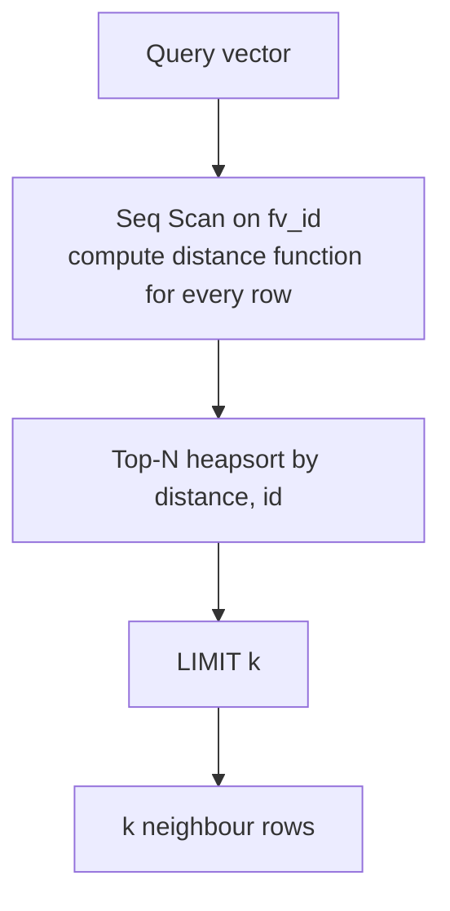

# Complete Educational and Scientific Audit

## Exact vs. Approximate Nearest Neighbor Search for Supervised KNN Classification: An Experimental Study Using PostgreSQL and pgvector

**Audit date:** 2026-11-20  
**Scope:** read-only inspection of source code, tests, documentation, result artifacts and the locally cached Covertype archive.  
**Not performed:** no source file was modified, no experiment was run, no test suite was executed, no SQL was sent to the application database, and no database content was changed.

### Evidence convention

- **Verified in source** — I read the implementation and can name the file and function/class.
- **Verified in artifacts** — I read and recomputed values from the committed CSV/JSON files.
- **Document claim only** — stated in a README/guide/thesis but not independently re-executed here.
- **Inference** — a scientific interpretation that follows from the code and artifacts but is not directly measured.

A statement such as “the validator reported zero errors” means *the artifacts are internally consistent with the stored experiment rows*, not that the scientific conclusions are proven. `backend/scripts/verify_results.py::main` checks structure, counts, flags and CSV/JSON/database agreement; it does **not** recompute recall, accuracy, latency percentiles or classification labels from raw per-query evidence.

---

## 1. Executive Summary

### 1.1 What this project actually is

This is a traditional, instance-based machine learning project. There is no training loop in the neural-network sense. “Training” means storing feature vectors and labels in PostgreSQL; “prediction” means asking the database for the `k` closest stored vectors and taking a majority vote over their labels. The research comparison is between two ways of finding those neighbours:

- **Exact search:** compute the distance from the query to every stored training vector, sort, take the best `k`.
- **Approximate search:** traverse a pgvector HNSW graph index, trading a small possibility of retrieving a different neighbour set for much lower latency.

The project is genuinely within the student’s background: KNN, distance metrics, class imbalance, stratified splitting, metrics and SQL. The web UI is a presentation layer; the research logic is in Python services and SQL.

### 1.2 What is scientifically trustworthy

The following claims are supported by the code and/or recomputed artifacts:

1. **The exact baseline cannot use the HNSW index by construction.**  
   `backend/app/services/vector_store.py::_distance_expr` uses pgvector distance *functions* (`l2_distance`, `cosine_distance`, `l1_distance`) for exact retrieval. `backend/app/services/metrics.py::DistanceMetric.function` defines them. An HNSW index satisfies operators such as `<->`, not arbitrary function calls.

2. **The HNSW arm deliberately uses the index-compatible operator form.**  
   `backend/app/services/vector_store.py::_distance_expr` emits `embedding <-> %s` when `use_operator=True`; `retrieve()` sets `use_op = method == "hnsw" and use_operator`.

3. **`ef_search` is applied and read back.**  
   `backend/app/services/vector_store.py::retrieve` uses session-level `SET hnsw.ef_search`, confirms it with `SHOW`, and `RESET`s it in a `finally` block. This fixes the documented `SET LOCAL` failure under `autocommit=True` in `backend/app/core/database.py::get_pool`.

4. **Plan verification exists, with a limitation.**  
   `backend/app/services/vector_store.py::plan_uses_index_scan` and `plan_uses_sequential_scan` parse `EXPLAIN (ANALYZE, BUFFERS)` text. `retrieve_batch()` verifies the plan on the first query of a batch only. The final artifacts report 36 HNSW index scans and 6 exact sequential scans.

5. **The final result artifacts are internally consistent with the recorded experiments.**  
   I recomputed the 14 configuration aggregates from `docs/results/sweep.csv`; they match the README and `docs/results/README.md` to the displayed precision. There are 42 rows, 71 columns, 3,000 unique queries, 3 repetitions, 2 fingerprints, 36 HNSW index-scan rows, 6 exact sequential-scan rows, 40 cache hits and 2 misses.

6. **Quality and latency measurement are separated correctly in most places.**  
   `backend/app/services/experiments.py::run_experiment` computes classification metrics per repetition, stores one row per repetition via `_insert_repetitions`, and stores every latency via `_insert_latencies`. Latency percentiles are computed from all stored observations by `backend/app/services/classification.py::latency_stats`.

7. **Index reuse accounting is honest.**  
   `backend/app/services/vector_store.py::ensure_hnsw_index` distinguishes a fresh build from a reuse; `run_experiment` stores `index_build_ms = NULL` and `index_reused_build_ms` on reuse. Only 2 of 42 artifact rows paid a build.

8. **Query selection is reproducible and shared.**  
   `backend/app/services/vector_store.py::select_test_ids` and `largest_remainder_allocation` implement seeded stratified selection. `query_samples.json` contains one identical 3,000-id set for all 42 experiments.

### 1.3 What is not trustworthy or must be qualified

The most important problems are not “the code is fake”; they are interpretation, documentation drift and a few real engineering defects.

| Severity | Finding | Primary evidence |
|---|---|---|
| **P0** | Two thesis documents present different experiments. The “Final-Verified” thesis matches v3; the older thesis still reports the ~1,000-query / 9,999-row benchmark. README lists both as the full thesis and its regeneration commands rebuild the old one. | `docs/Thesis-Final-Verified.docx`; `docs/Thesis-KNN-PostgreSQL-Platform.docx`; `README.md` “Further reading”; `docs/tools/build_thesis.py::OUTPUT`; `docs/tools/build_final_thesis.py::OUTPUT` |
| **P0** | The 10,000-row experiment uses a scaler fitted on the full 50,000-row training pool, because the runner deletes rows *after* ingestion. This is not test leakage, but it is a training-size confound: the two pool sizes did not receive the same preprocessing fit. | `backend/scripts/run_experiments.py::subset_dataset`; `backend/app/services/experiments.py::run_experiment` (`state = PreprocessState.from_dict(...)`); `backend/app/api/datasets.py::_ingest_frame` |
| **P0** | Dataset list/get endpoints omit `preprocessing_mode`, which their own response model requires. This should fail response validation and break UI dataset loading. | `backend/app/api/datasets.py::list_datasets`, `get_dataset`; `backend/app/api/schemas.py::DatasetSummary` |
| **P0** | A database password is hard-coded as a default and copied into the example environment file. | `backend/app/core/config.py::Settings.postgres_password`; `backend/.env.example` |
| **P1** | “Results verified” is overstated. The verifier checks artifact/database consistency, not scientific correctness from raw samples. | `backend/scripts/verify_results.py::main`; `README.md` “Validate the artifacts” |
| **P1** | Four Covertype continuous columns are misnamed in the source; the cached UCI file shows hillshade values where the code says roadway/hydrology elevation features. | `backend/app/services/datasets.py::COVERTYPE_COLUMNS`; local `backend/data/covertype.csv.gz` first rows |
| **P1** | The HNSW access path is checked only on the first query of a batch. | `backend/app/services/vector_store.py::retrieve_batch`, `retrieve` |
| **P1** | The aggregate confusion matrix and per-class table come from the *last* repetition, not an average over repetitions, while other aggregate quality metrics are means. | `backend/app/services/experiments.py::run_experiment` (`last_metrics`) |
| **P1** | Tie-aware Recall@K divides by `len(got)`, while its docstring and docs describe division by `k`. Harmless at `k=5` with 5 returned ids, but still a contract mismatch. | `backend/app/services/classification.py::tie_aware_recall_at_k` |
| **P1** | Two different percentile implementations are used: NumPy linear interpolation in the service and nearest-rank with a 5,000-row limit in the API. | `backend/app/services/classification.py::latency_stats`; `backend/app/api/experiments.py::latency_samples` |
| **P1** | The README test count (241 passed, 1 skip) could not be verified. The pytest cache contains 261 collected node IDs and 7 stale failure entries. I did not run pytest because it would write to the database. | `README.md`; `backend/.pytest_cache/v/cache/nodeids`; `backend/.pytest_cache/v/cache/lastfailed` |
| **P1** | The frontend does not surface several recorded fields, and UI runs use `query_sampling="first"` by default while the benchmark used `"stratified"`. | `frontend/components/experiment-result-panel.tsx`; `frontend/components/experiment-runner.tsx`; `backend/app/api/schemas.py::ExperimentRequest` |
| **P2** | Requirements use `>=`, so installed versions are not pinned although docs claim pinned versions. | `backend/requirements.txt`; `docs/essential-steps.md` |
| **P2** | The runner’s module docstring still says a seeded PostgreSQL `setseed` is used; the implementation uses Python `random.Random(f"{seed}:{label}")`. | `backend/scripts/run_experiments.py` module docstring vs `subset_dataset` |
| **P2** | `api_overhead_s` remains a database column and is referenced by a test, even though docs say the field was retired. | `backend/app/db/schema.py::SCHEMA_SQL`, `MIGRATION_SQL`; `backend/tests/test_timing_accounting.py::test_phases_are_nonnegative_and_do_not_exceed_total`; `README.md` |

### 1.4 Defensible final claim

A defensible sentence for the academic report is:

> On this machine, for UCI Covertype with 54 standardised/binary features, L2 distance, `k=5`, a warm buffer cache and one query per round-trip, HNSW reduced median retrieval latency by 6.8×–45.1× while Recall@5 changed from 1.0000 to 0.9854–0.9999 and accuracy differed from exact by at most 0.17 percentage points in the measured configurations.

Claims that must **not** be made:

- that HNSW is always exact, or that higher `ef_search` must monotonically improve recall;
- that HNSW search is provably logarithmic on this dataset;
- that passing tests proves the published numbers;
- that results generalise to other datasets, metrics, `k`, cold caches, batched workloads or hardware;
- that the 10,000-row arm was preprocessed exactly as a fresh 10,000-row dataset would be;
- that the older thesis and the final verified thesis describe the same experiment.

---

## 2. Repository Architecture

### 2.1 Overall architecture

| Layer | Technology | Responsibility | Main first-party location |
|---|---|---|---|
| Presentation | Next.js 16, TypeScript, Tailwind v4, Recharts, next-intl | Dataset upload, experiment configuration, result visualisation, bilingual EN/FA UI | `frontend/` |
| API | FastAPI, Pydantic | HTTP validation, routing, JSON serialisation | `backend/app/api/` |
| Research services | Python, NumPy, pandas, scikit-learn | Preprocessing, retrieval, voting, metrics, orchestration, statistics | `backend/app/services/` |
| Batch runner | argparse, csv, json | Reproducible experiment matrix, balanced rounds, artifact export | `backend/scripts/run_experiments.py` |
| Persistence | PostgreSQL 18, psycopg 3, psycopg_pool | Vector tables, HNSW index, experiment rows, latency rows | `backend/app/db/`, `backend/app/core/database.py` |
| Vector engine | pgvector 0.8.7 | `vector(dim)`, distance functions/operators, HNSW index | `pgvector/`, SQL emitted by `vector_store.py` |

The frontend never talks to PostgreSQL. It calls FastAPI over HTTP; FastAPI calls Python services; services open pooled PostgreSQL connections. The batch runner bypasses HTTP and calls the same `run_experiment` service directly, which is why its numbers are comparable to API-produced experiments.

### 2.2 Backend structure and module responsibilities

Every important module is described in terms of what it does, why it exists, who calls it, what it returns and which research responsibility it serves.

| Module | What it does | Why it exists | Called by | Returns | Research responsibility |
|---|---|---|---|---|---|
| `backend/app/main.py::lifespan` | Creates the database if missing, applies schema, closes pool on shutdown | Makes startup idempotent and avoids manual schema setup | Uvicorn/FastAPI | `None` | Infrastructure readiness |
| `backend/app/core/config.py::Settings` | Loads environment variables and builds DB URLs | Central configuration | Nearly every backend module | Settings object | Reproducibility metadata and connectivity |
| `backend/app/core/database.py::get_pool`, `connection`, `fetch_all`, `fetch_one`, `execute` | Manages a psycopg connection pool with `autocommit=True` and dictionary rows | Avoids opening a connection per operation; explains the `SET LOCAL` bug | Services, API, scripts | Connection/rows/`None` | Shared database access |
| `backend/app/core/environment.py::capture_environment` | Records Python, OS, CPU, memory, DB and package versions | Allows latency numbers to be interpreted in context | `experiments.run_experiment` | JSON-ready dict | External-validity metadata |
| `backend/app/db/schema.py::SCHEMA_SQL`, `MIGRATION_SQL`, `migration_statements` | Defines datasets, HNSW registry, experiments, repetitions and latency tables | Stable storage contract for every measured value | `init_db.init_schema` | SQL statements | Persisted evidence model |
| `backend/app/db/init_db.py::ensure_database_exists`, `init_schema` | CREATE DATABASE if absent; apply idempotent migrations | Zero-admin setup | `main.lifespan` | `None` | Schema bootstrap |
| `backend/app/services/metrics.py::DistanceMetric` | Maps `l2/cosine/l1` to pgvector operators, functions and labels | Encodes the function-vs-operator distinction in one place | `vector_store`, `experiments`, scripts | Strings/enum values | Retrieval-semantics definition |
| `backend/app/services/vector_store.py` | Table lifecycle, COPY ingestion, index build/reuse, exact/HNSW retrieval, ground truth, plan checks | Implements the entire database-side retrieval experiment | `experiments`, `dataset_stats`, API ingestion, runner | `RetrievalResult`, `BatchResult`, `GroundTruth`, `IndexInfo`, metadata | Core independent variable: exact vs approximate retrieval |
| `backend/app/services/preprocessing.py` | Fit/transform pipeline, validation, label encoding, vector literals | Prevents leakage and guarantees identical train/test geometry | `api/datasets._ingest_frame`, tests | `PreprocessState`, `Preprocessor`, matrices, strings | Data-quality and leakage control |
| `backend/app/services/datasets.py` | Covertype download/cache/load, upload parsing, stratified split, row subsampling | Turns raw data into train/test frames | `api/datasets`, tests | DataFrames, paths, distributions | Dataset provenance and sampling |
| `backend/app/services/classification.py` | Majority vote, classification metrics, Recall@K variants, latency percentiles, repetition summaries | Turns neighbour ids/labels into scientific measurements | `experiments`, tests | Scalars/dicts/dataclasses | Dependent variables: quality and latency |
| `backend/app/services/dataset_stats.py` | Dataset fingerprint, duplicate-vector stats, tie stats | Empirical checks for “ties explain recall loss” claims | `scripts/dataset_statistics.py`, `experiments` | Dicts, SHA-256 fingerprint | Threat-to-validity measurement |
| `backend/app/services/benchmark_order.py::balanced_rounds`, `positions` | Seeded permutations with rotation | Prevents fixed exact-first ordering confound | `scripts/run_experiments.py::main` | `list[list[str]]` | Order-fairness control |
| `backend/app/services/experiments.py::run_experiment` | Orchestrates index, ground truth, timed retrieval, metrics, persistence and timing | Single source of truth for one experiment row | API `/experiments/run`, batch runner | Flat result dict plus persisted rows | Experimental unit |
| `backend/app/services/experiments.py::compare_experiments` | Computes deltas and latency ratios between two rows | Supports UI side-by-side comparison | API `/experiments/compare` | Dict with `deltas` | Interpretation aid |
| `backend/app/scripts/run_experiments.py` | Parses CLI, builds matrix, subsamples pool, runs rounds, writes CSV/JSON | Produces reproducible benchmark artifacts | Human/terminal | Artifact files, exit code | Experiment execution and provenance |
| `backend/app/scripts/verify_results.py::main` | Checks headers, counts, ids, flags, seeds, cache/timing presence | Guards against accidental artifact drift | Human/terminal | JSON verification summary and exit code | Artifact integrity, not scientific proof |
| `backend/app/scripts/dataset_statistics.py::main` | Writes duplicate/tie statistics | Supports interpretation of Recall@K | Human/terminal | `duplicate_stats.json` | Empirical tie/duplicate audit |
| `backend/app/api/datasets.py` | Upload/ingest/list/delete/status endpoints | Exposes data preparation to the UI | Frontend HTTP client | Pydantic models/dicts | User-facing pipeline control |
| `backend/app/api/experiments.py` | Run/list/get/compare/delete/latency/repetition/explain endpoints | Exposes research services to UI | Frontend HTTP client | JSON | User-facing experiment control |
| `backend/app/api/health.py::health` | Reports DB and pgvector status | Fast readiness check | Frontend health badge | `HealthResponse` | Operational visibility |

### 2.3 Frontend structure

| Area | Files | Responsibility |
|---|---|---|
| Locale routing | `frontend/proxy.ts`, `frontend/i18n/routing.ts`, `frontend/i18n/request.ts`, `frontend/i18n/navigation.ts`, `frontend/app/[locale]/layout.tsx` | EN/FA routes and RTL layout |
| Pages | `frontend/app/[locale]/page.tsx`, `datasets/page.tsx`, `experiments/page.tsx`, `compare/page.tsx`, `methodology/page.tsx` | Thin route wrappers |
| Feature components | `overview-content.tsx`, `datasets-content.tsx`, `experiments-content.tsx`, `experiment-runner.tsx`, `experiment-result-panel.tsx`, `compare-content.tsx`, `methodology-content.tsx` | User workflows |
| UI primitives | `frontend/components/ui/*` | Reusable Radix/shadcn-style widgets |
| HTTP client | `frontend/lib/api.ts::request`, `getHealth`, `listDatasets`, `runExperiment`, `compareExperiments`, `getLatencySamples` | Calls `${NEXT_PUBLIC_API_URL}/api/...` with `cache: "no-store"` |
| Types | `frontend/types/api.ts` | TypeScript mirror of backend concepts |
| State | `frontend/providers/query-provider.tsx`, `theme-providers.tsx` | React Query caching and theme |

Confirmed communication path for an experiment:

1. User presses Run in `frontend/components/experiment-runner.tsx::runMutation`.
2. `frontend/lib/api.ts::runExperiment` sends `POST /api/experiments/run` with JSON.
3. `backend/app/api/experiments.py::run` validates with `ExperimentRequest` and builds `ExperimentConfig`.
4. `backend/app/services/experiments.py::run_experiment` performs the measurement and persists rows.
5. Frontend invalidates React Query keys; `experiment-result-panel.tsx` fetches the experiment and latency samples.

A separate, non-HTTP path exists for research artifacts:

1. `backend/scripts/run_experiments.py::main` constructs configurations directly.
2. It calls `run_experiment` for every configuration/round.
3. It reads results back from the DB and writes `sweep.csv`, `sweep.json`, `repetition_details.csv`, `repetition_summary.csv`, `query_samples.json`, `benchmark_orders.json`.

### 2.4 Database schema

| Object | Defined in | Purpose |
|---|---|---|
| `datasets` | `backend/app/db/schema.py::SCHEMA_SQL` | Dataset name, source, dimension, classes, fitted preprocessing state, fingerprint-related metadata, preprocessing mode |
| `fv_<dataset_id>` | `backend/app/services/vector_store.py::create_dataset_tables` | Training pool; `id`, `row_index`, `label SMALLINT`, `embedding vector(dim)`; HNSW index lives here |
| `tv_<dataset_id>` | `create_dataset_tables` | Held-out query pool with the same typed vector column |
| `hnsw_indexes` | `schema.py::SCHEMA_SQL` | Registry of metric, `m`, `ef_construction`, build time and physical size |
| `experiments` | `schema.py::SCHEMA_SQL` | One row per configuration/round: quality, latency, timing, plan, seeds, environment, JSON payloads |
| `experiment_repetitions` | `schema.py::SCHEMA_SQL` | One row per complete timed pass; quality and latency distribution for that pass |
| `query_latencies` | `schema.py::SCHEMA_SQL` | One row per measured query: repetition, query index, latency, retrieved ids |
| `datasets_name_idx`, `experiments_dataset_idx`, `query_latencies_experiment_idx`, `experiment_repetitions_experiment_idx`, `fv/tv row_index` indexes | `schema.py`, `create_dataset_tables` | Ordinary relational lookup indexes, not vector indexes |

One table pair per dataset is deliberate: `vector(dim)` is required for HNSW, and pgvector applies residual `WHERE` filters after the index scan. A shared table with `dataset_id = ...` could return neighbours from other datasets. This rationale appears in `schema.py` module docstring and `docs/architecture.md`.

### 2.5 Experiment execution pipeline

`backend/app/services/experiments.py::run_experiment` performs these steps:

1. Load dataset row and `PreprocessState` (lines 181–186).
2. Select test ids with `vs.select_test_ids` (188–193) and load `(id, label, embedding_text)` via `vs.load_test_vectors_by_ids` (194–200).
3. Count train/test rows and compute class distributions (202–205).
4. Compute pool fingerprint with `dataset_stats.dataset_fingerprint` (208).
5. Build or reuse HNSW for HNSW runs, or just `ANALYZE` for exact runs (210–253).
6. Build tie tolerance, compute/lookup keyed ground truth (255–286).
7. Run `vs.retrieve_batch` with real repetitions (288–299).
8. For each repetition: `majority_vote`, `evaluate_predictions`, `latency_stats`, `recall_at_k`, `tie_aware_recall_at_k` (301–338).
9. Compute aggregate latency and cross-repetition summaries (345–368).
10. Build payload with seeds, distributions, fingerprints, environment and timing (376–483).
11. Persist experiment, repetition rows and latency rows (485–489).
12. Fill timing columns with a second UPDATE and return flat dict (491–559).

`backend/scripts/run_experiments.py::main` wraps this in a matrix: sizes × rounds × configurations, with pool snapshot/restore in a `finally` block (500, 507–570).

### 2.6 Dataset ingestion and preprocessing path

`backend/app/api/datasets.py::_ingest_frame`:

1. Validate target column and dataset (`validate_dataset`).
2. `datasets.stratified_split` with absolute `test_size`.
3. `datasets.sample_training_rows` if `max_train_rows` is set.
4. `fit_preprocessor(train_df, ...)` — training split only.
5. `transform(train_df)` and `transform(test_df)` using the same fitted state.
6. Check equal dimension.
7. `vector_literal` converts float rows to `"[1.2,3.4,...]"`.
8. Insert `datasets` row, create `fv_/tv_` tables, `insert_vectors` via `COPY`.
9. On failure, delete dataset row and drop tables.

### 2.7 Dependency diagram

```mermaid
flowchart TD
    Browser[Browser / Student] -->|HTTP JSON| FE[Next.js frontend<br/>lib/api.ts]
    FE -->|POST /api/experiments/run| API[FastAPI<br/>api/experiments.py::run]
    FE -->|POST /api/datasets/*| DAPI[FastAPI<br/>api/datasets.py]
    FE -->|GET compare / latency| API

    DAPI --> DS[services/datasets.py<br/>stratified_split, load_covertype]
    DAPI --> PP[services/preprocessing.py<br/>fit_preprocessor, transform]
    DAPI --> VS[services/vector_store.py<br/>create_dataset_tables, insert_vectors]

    API --> EX[services/experiments.py<br/>run_experiment]
    Runner[scripts/run_experiments.py<br/>main] -->|direct call, no HTTP| EX
    Runner --> BO[services/benchmark_order.py<br/>balanced_rounds]
    Runner --> VS

    EX --> VS
    EX --> CL[services/classification.py<br/>majority_vote, metrics, recall]
    EX --> DST[services/dataset_stats.py<br/>dataset_fingerprint]
    EX --> ENV[core/environment.py<br/>capture_environment]
    EX --> MET[services/metrics.py<br/>DistanceMetric]

    VS --> DB[(PostgreSQL 18)]
    DST --> DB
    EX --> DB
    Runner -->|read back rows| DB
    Runner --> ART[docs/results/*.csv<br/>*.json]
    Verify[scripts/verify_results.py::main] --> ART
    Verify --> DB
    Stats[scripts/dataset_statistics.py::main] --> DST
    Stats --> DUP[duplicate_stats.json]

    DB --> PG[(pgvector 0.8.7<br/>vector(dim), HNSW)]
```

### 2.8 Research-pipeline dependency map

```mermaid
flowchart LR
    RAW[UCI Covertype CSV] --> SPLIT[stratified_split<br/>seed 42]
    SPLIT --> TRAIN[Training split]
    SPLIT --> TEST[Held-out test split]
    TRAIN --> FIT[fit_preprocessor<br/>statistics from train only]
    FIT --> TFRAIN[transform train]
    FIT --> TTEST[transform test]
    TFRAIN --> FV[fv_dataset<br/>COPY vectors]
    TTEST --> TV[tv_dataset<br/>COPY vectors]
    FV --> IDX[HNSW index<br/>m=16, ef_construction=64]
    FV --> GT[Exact ground truth<br/>function form]
    TV --> Q[Selected query ids]
    Q --> GT
    Q --> RET[Retrieval under test<br/>exact or HNSW]
    IDX --> RET
    GT --> REC[Recall@K + tie-aware]
    RET --> VOTE[majority_vote]
    VOTE --> CLS[accuracy, precision, recall, F1, confusion]
    RET --> LAT[latency percentiles]
    REC --> ROW[experiments row]
    CLS --> ROW
    LAT --> ROW
    ROW --> REP[experiment_repetitions]
    ROW --> LATROW[query_latencies]
    REP --> CSV[repetition CSVs]
    LATROW --> JSON[verification artifacts]
```

---

## 3. KNN Fundamentals

### 3.1 How a training sample is represented

A Covertype row becomes:

- `id`: database identity used for deterministic tie-breaking;
- `row_index`: original position in the split frame;
- `label`: encoded class index `0..6`, stored as `SMALLINT`;
- `embedding`: `vector(54)` text such as `[0.42,-1.10,...,1]`.

This is created by `backend/app/services/vector_store.py::create_dataset_tables`, filled by `insert_vectors`, and the vector text is produced by `backend/app/services/preprocessing.py::vector_literal`.

The label is **encoded**, not the original UCI class number 1–7. `fit_preprocessor` builds `label_to_index`; `_encode_labels` maps original labels to indices. `evaluate_predictions` therefore compares encoded indices, while `per_class_metrics` reports original labels via `class_labels`.

### 3.2 How features become vectors

`backend/app/services/preprocessing.py::Preprocessor.transform`:

- numeric block: coerce to numeric, fill with training medians, `StandardScaler.transform`, cast to `float32`;
- binary block: coerce, fill with training modes, optionally scale only in `standardize_all`, cast to `float32`;
- categorical block: one-hot over training vocabulary, unseen values become all-zero;
- concatenate numeric + binary + one-hot with `np.hstack`, in fixed `state.output_columns` order.

`fit_preprocessor` learns medians, modes, vocabularies and scaler parameters **only from the training frame**. That is the central leakage-prevention design.

**Small scaling example.** Suppose feature A ranges 0–1000 and feature B ranges 0–1. Without scaling, an L2 distance is dominated by A. After standardisation, `z = (x - mean) / std`, both features contribute on comparable scales. For Covertype’s 44 binary indicators, the primary `covertype` mode leaves them as 0/1 because they are already dimensionless; this is a deliberate geometry choice, not an oversight.

### 3.3 A complete prediction trace

Suppose:

```text
query q = [1, 1]
training rows in fv_1:
  id=1, x1=[1,2], label index 0
  id=2, x2=[2,1], label index 1
  id=3, x3=[5,5], label index 1
k = 2, metric = L2, method = exact
```

Step by step:

1. **Representation.** Each `x` is stored as `vector(2)` in `fv_1`; labels are `SMALLINT`.  
   Files: `vector_store.py::create_dataset_tables`, `insert_vectors`.

2. **Vector formation.** The query is converted to `"[1,1]"` by `vector_literal` (or loaded from `tv_<id>` as `embedding::text`).  
   Files: `preprocessing.py::vector_literal`, `vector_store.py::load_test_vectors_by_ids`.

3. **Distance calculation.** `_distance_expr(metric, use_operator=False)` emits `l2_distance(embedding, %s::vector)`.  
   Distances:
   - `d(q,x1) = sqrt((1-1)^2 + (1-2)^2) = 1`
   - `d(q,x2) = sqrt((1-2)^2 + (1-1)^2) = 1`
   - `d(q,x3) = sqrt((1-5)^2 + (1-5)^2) = sqrt(32) ≈ 5.657`

4. **Nearest K retrieval.** `_query_sql` orders by `distance, id` for exact search. The two distance-1 rows tie; `id=1` comes first, then `id=2`. Retrieved ids: `[1, 2]`.  
   File: `vector_store.py::_order_expr`, `retrieve`.

5. **Majority voting.** Labels are `[0, 1]`. `classification.majority_vote` tallies `{0:1, 1:1}` and selects by `(weight, -label)`, so the smaller numeric label wins: predicted class `0`.  
   File: `classification.py::majority_vote`.

6. **Class selection.** If labels were `[0, 1, 1]`, tally `{0:1, 1:2}` → prediction `1`. With distances `[1, 2, 2]` and `weighted_voting=True`, weights `[1, 0.5, 0.5]`; class 0 gets 1.0 and class 1 gets 1.0 → tie → class 0.

7. **Metrics.** Suppose the true label of `q` is `0`. `evaluate_predictions([0], [0], [0,1])` gives accuracy `1`, class-0 recall `1`, class-1 precision `0` (no predicted/supporting class-1 example), macro F1 computed over both classes.  
   File: `classification.py::evaluate_predictions`.

The batch version repeats steps 3–6 `repetitions` times via `vector_store.py::retrieve_batch`, and `experiments.py::run_experiment` computes metrics per pass.

### 3.4 Distance formulas

#### Euclidean / L2

Implemented as pgvector `l2_distance` (function) and `<->` (operator).

\[
d_2(q,x)=\sqrt{\sum_{j=1}^{D}(q_j-x_j)^2}
\]

Example with `q=[0,0]`, `x=[3,4]`: `sqrt(9+16)=5`.

#### Manhattan / L1

Implemented as `l1_distance` and `<+>`.

\[
d_1(q,x)=\sum_{j=1}^{D}|q_j-x_j|
\]

Example: `q=[0,0]`, `x=[3,4]` → `3+4=7`.

#### Cosine distance

Implemented as `cosine_distance` and `<=>`.

\[
\cos(q,x)=\frac{q\cdot x}{\|q\|\|x\|},\qquad d_{\cos}=1-\cos(q,x)
\]

Example: `q=[1,0]`, `x=[0,1]` → dot `0`, norms `1`, distance `1`.  
For collinear vectors `x=[2,4]`, `q=[1,2]` → cosine `1`, distance `0`.

Important caveat documented in `docs/experiment-plan.md::E4`: vectors are **not L2-normalised** before a cosine run. Feature standardisation is not the same as unit-norm normalisation, so cosine results would need separate interpretation. Cosine was not part of the final full sweep.

### 3.5 Voting formulas

Simple majority:

\[
\hat{y}=\arg\max_c \#\{i : y_i=c\}
\]

The deterministic tie rule in `majority_vote` is:

```text
max by (tally_weight, -label)
```

so equal scores choose the smaller encoded label.

Weighted voting, implemented but not used in the final experiments:

\[
w_i=\frac{1}{d_i+\epsilon},\qquad \epsilon=10^{-9}
\]

\[
\hat{y}=\arg\max_c \sum_{i:y_i=c} w_i
\]

Example: labels `[0,1,1]`, distances `[1,3,5]` → class 0 weight `1/(1+eps)≈1`, class 1 weight `1/3+1/5≈0.533` → prediction 0. This shows distance weighting can overturn a simple majority.

### 3.6 Classification metrics

For class `c`, from the confusion matrix:

- `TP_c = matrix[c][c]`
- `FP_c = column_sum(c) - TP_c`
- `FN_c = row_sum(c) - TP_c`

\[
\text{precision}_c=\frac{TP_c}{TP_c+FP_c},\quad
\text{recall}_c=\frac{TP_c}{TP_c+FN_c}
\]

\[
F1_c=\frac{2P_cR_c}{P_c+R_c}
\]

\[
\text{accuracy}=\frac{\sum_c TP_c}{\sum_{i,j}matrix[i][j]}
\]

\[
\text{macro F1}=\frac{1}{C}\sum_c F1_c
\]

Macro F1 is important here because Covertype is imbalanced: it gives all seven classes equal weight rather than letting large classes dominate.

**Numerical example.** Confusion matrix for two classes:

```text
        pred 0  pred 1
true 0     8      2
true 1     1      9
```

Accuracy `(8+9)/20 = 0.85`.

Class 0: `TP=8, FP=1, FN=2` → `P=8/9=0.889`, `R=8/10=0.8`, `F1=2*0.889*0.8/(1.689)≈0.842`.

Class 1: `TP=9, FP=2, FN=1` → `P=9/11≈0.818`, `R=9/10=0.9`, `F1≈0.857`.

Macro F1 `≈(0.842+0.857)/2=0.850`.

### 3.7 Retrieval metrics

Conventional Recall@K from `classification.py::recall_at_k`:

\[
\text{Recall@K}=\frac{1}{Q}\sum_{q=1}^{Q}\frac{|R_q\cap G_q|}{|G_q|}
\]

where `G_q` is the exact top-k deterministic id list.

Example: retrieved `[2,5,9]`, ground truth `[2,5,7]` → `2/3`.

Tie-aware Recall@K from `classification.py::tie_aware_recall_at_k`:

\[
\text{TieRecall@K}=\frac{1}{Q}\sum_q \frac{|R_q\cap C_q|}{|R_q|}
\]

where `C_q` is every id within the K-th boundary tolerance. In the current implementation the denominator is `len(got)`; since the system always returns `k=5`, this equals the documented `k` in the final benchmark. The wording in the docstring still says `/ k`.

Boundary tolerance from `vector_store.py::TieTolerance` and `_ground_truth_sql`:

\[
d \le b(1+\text{relative})+\text{absolute}
\]

with defaults `relative=1e-6`, `absolute=1e-6`.

### 3.8 Latency percentiles

`classification.py::latency_stats` uses `np.percentile(arr, p)` with NumPy’s default linear interpolation across the sorted observations. For sorted samples `x_(1)..x_(n)`, p50 is the median, p95 approximates the value below which 95% of observations fall, and p99 the value below which 99% fall.

The API endpoint `api/experiments.py::latency_samples` instead uses nearest-rank percentages and limits to 5,000 rows. This is a real inconsistency, not a mathematical equivalence.

---

## 4. Exact Search

### 4.1 How exhaustive nearest-neighbor search works

Exact KNN computes the distance from the query to every row in `fv_<dataset_id>`, orders the results and keeps the smallest `k`. It is ground truth **for the stored vectors and chosen distance function** because no candidate is skipped.

### 4.2 Complexity

Let `n` be the number of training vectors and `d` the dimension.

- distance computations: `n`, each costing `O(d)`;
- distance work: `O(nd)`;
- PostgreSQL uses top-N heapsort for `ORDER BY distance LIMIT k`, approximately `O(n log k)` comparisons rather than a full `O(n log n)` sort;
- memory is bounded by the heap and scan state, not by a materialised full table copy.

The observed scaling in the artifacts is consistent with this: exact p50 rose from 2.823 ms at 10,000 rows to 11.063 ms at 50,000 rows (about 3.9× for 5× more rows).

### 4.3 Actual SQL and PostgreSQL execution

`backend/app/services/vector_store.py::_query_sql` builds:

```sql
SELECT id, label, l2_distance(embedding, %s::vector) AS distance
FROM fv_<id>
ORDER BY l2_distance(embedding, %s::vector), id
LIMIT %s;
```

`_distance_expr` selects `l2_distance` / `cosine_distance` / `l1_distance`; `_order_expr` adds the `id` tiebreak only to the exact path.

`_explain_sql` wraps the same query in `EXPLAIN (ANALYZE, BUFFERS, FORMAT TEXT)`. The documented plan shape is:



No HNSW index can satisfy a bare function call, so the planner cannot choose the index for this shape. This is stronger evidence than simply dropping the index: even if the index exists, the exact query still performs a sequential scan. `backend/tests/test_vector_store.py::TestExactRetrieval::test_exact_falls_back_when_index_exists` checks this behaviour against a live database.

### 4.4 How the project verifies no HNSW index is used

- `backend/app/services/vector_store.py::plan_uses_sequential_scan` looks for `"seq scan"` in the plan text.
- `plan_uses_index_scan(plan, index_name_)` requires the exact named index when checking HNSW.
- `RetrievalResult.used_sequential_scan` and `used_index_scan` store the booleans.
- `backend/scripts/verify_results.py::main` requires every exact row to have `used_index_scan=False` and `environment.used_sequential_scan=True`.
- `docs/results/sweep.csv` contains 6 exact rows; all report sequential scans.

**Limitation:** `retrieve_batch` verifies the plan only for the first query (`first = repetition == 0 and i == 0` in `vector_store.py`). If the planner changed access path for later executions, the batch-level flag would not detect it. For the exact path the SQL function form makes this unlikely; for HNSW it is a more meaningful threat.

### 4.5 Ground truth and ties

`backend/app/services/vector_store.py::_ground_truth_sql` computes:

1. `scored`: distance from the query to every training row using the function form;
2. `boundary`: the `k`-th smallest distance (`OFFSET k-1`), falling back to the maximum if fewer than `k` rows;
3. outer select: every row within `boundary * (1 + rel) + abs`, ordered by `(distance, id)`.

`ground_truth_candidates` turns rows into `GroundTruth(ids, distances, boundary, candidate_ids, candidate_labels)`. `ids[:k]` is the deterministic conventional reference; `candidate_ids` is the tie-aware reference.

This is a good design because the K-th id is deterministic and the tolerance is persisted per experiment. The measured pool had zero boundary ties over 3,000 queries (`docs/results/duplicate_stats.json`), so conventional and tie-aware recall coincide in the final artifacts.

---

## 5. Approximate Search and HNSW

### 5.1 What Approximate Nearest Neighbor means

ANN search returns neighbours that are *probably close* to the query without examining every vector. “Approximate” refers to the **candidate set**, not to the distance arithmetic: returned distances are real pgvector distances; the search procedure may miss the true top-k ids.

### 5.2 What HNSW is

Hierarchical Navigable Small World is a graph index. Vectors are nodes. Edges connect nearby nodes. The graph is organised in layers:

- upper layers are sparse “express lanes”;
- lower layers are denser;
- search starts at an entry point in the top layer, greedily moves to closer nodes, then descends;
- at the bottom layer it keeps a candidate list of size `ef_search`.


This is a heuristic navigational structure. It often gives excellent recall/latency trade-offs, but it does not provide a deterministic guarantee that the exact top-k are returned. The statement in `docs/Thesis-KNN-PostgreSQL-Platform.docx` that search cost is “close to logarithmic” should be presented as an empirical expectation, not a theorem for this dataset.

### 5.3 M, ef_construction and ef_search

| Parameter | Where used | Meaning | Effect |
|---|---|---|---|
| `m` | Build time, `_build_hnsw_index` | Maximum connections per node | Higher `m`: better connectivity/recall, more memory and build time |
| `ef_construction` | Build time, `_build_hnsw_index` | Candidate-list size while building the graph | Higher: better graph quality, slower build |
| `ef_search` | Query time, `retrieve` | Candidate-list size during search | Higher: more graph exploration, usually higher recall and higher latency |

The benchmark fixes `m=16`, `ef_construction=64` and varies `ef_search` over `10,25,50,100,200,400`. This is methodologically sound because `ef_search` is a query-time GUC; changing it should not require an index rebuild.

### 5.4 How the pgvector index is constructed

`backend/app/services/vector_store.py::_build_hnsw_index`:

1. selects opclass: `vector_l2_ops`, `vector_cosine_ops` or `vector_l1_ops` from `DistanceMetric`;
2. drops any old named index;
3. `SET maintenance_work_mem = '512MB'` on that connection;
4. executes:

```sql
CREATE INDEX fv_<id>_embedding_hnsw_idx
ON fv_<id>
USING hnsw (embedding vector_l2_ops)
WITH (m = 16, ef_construction = 64);
```

5. measures wall time with `time.perf_counter()`;
6. reads `pg_relation_size` via `index_size_bytes`;
7. upserts the `hnsw_indexes` registry.

`ensure_hnsw_index` reuses the physical index only when metric, `m`, `ef_construction` and physical presence all match. Reused rows report historical build time separately.

### 5.5 How the planner chooses the index

`retrieve()` with `method="hnsw"` sets `use_op=True`, so `_distance_expr` emits `embedding <-> %s`. With an `ORDER BY embedding <-> $1 LIMIT k` query, `ANALYZE` statistics, and a suitable HNSW index, PostgreSQL’s planner can satisfy the ordering with an index scan.

`run_experiment` calls `vs.analyze()` during index preparation so planner statistics are fresh. The resulting plan is stored in `BatchResult.plan` and parsed by `plan_uses_index_scan`.

The HNSW query deliberately does **not** add `ORDER BY distance, id`: `docs/architecture.md` notes that the secondary sort key would make the planner abandon the index scan. This is why deterministic tie-breaking is applied to exact retrieval and ground truth, but not to the HNSW measurement query.

### 5.6 Why `ef_search` affects latency and recall

With `ef_search=10`, HNSW keeps a small candidate list and visits fewer nodes. It is fast but more likely to miss a true neighbour. With `ef_search=400`, it explores a much larger portion of the graph. More candidates generally improve recall but cost more distance computations.

Observed at 50,000 rows:

| ef_search | Recall@5 | p50 latency | Speed-up vs exact |
|---:|---:|---:|---:|
| — exact | 1.0000 | 11.063 ms | — |
| 10 | 0.9854 | 0.246 ms | 45.1× |
| 25 | 0.9942 | 0.280 ms | 39.6× |
| 50 | 0.9974 | 0.363 ms | 30.6× |
| 100 | 0.9989 | 0.465 ms | 23.8× |
| 200 | 0.9997 | 0.753 ms | 14.7× |
| 400 | 0.9998 | 1.224 ms | 9.1× |

This is the classic knee-shaped trade-off: moving 10→100 buys most of the recall recovery; 200→400 buys very little and costs more latency.

**Important nuance:** higher `ef_search` is not guaranteed to produce higher recall in every query because graph traversal is heuristic and the surviving candidate list can change. `docs/experiment-plan.md::E2` correctly states this. Do not claim monotonicity as a law.

---

## 6. Dataset and Preprocessing

### 6.1 Dataset characteristics

The primary dataset is UCI Forest CoverType:

- 581,012 rows in the full archive;
- 55 columns: 54 features plus label;
- 7 classes (original labels 1–7, encoded internally as 0–6);
- 10 continuous features;
- 44 binary indicators: 4 wilderness-area flags and 40 soil-type flags.

The final experiment used dataset 116: 50,000 training rows and 3,000 held-out rows. The class distribution in the held-out pool was:

| Encoded label | Rows | Share |
|---:|---:|---:|
| 0 | 1,094 | 36.47% |
| 1 | 1,463 | 48.77% |
| 2 | 184 | 6.13% |
| 3 | 14 | 0.47% |
| 4 | 49 | 1.63% |
| 5 | 90 | 3.00% |
| 6 | 106 | 3.53% |

This is substantial imbalance. Accuracy alone would mostly reflect classes 0 and 1.

### 6.2 Continuous versus binary features

`backend/app/services/preprocessing.py::infer_column_types` classifies a numeric column as binary when all non-null values are in `{0,1}`. Otherwise it is continuous. Non-numeric columns are categorical and one-hot encoded.

In `PreprocessingMode.COVERTYPE`:

- continuous columns are median-imputed and standardised;
- binary columns are mode-imputed and left as 0/1;
- one-hot blocks are never standardised.

In `PreprocessingMode.STANDARDIZE_ALL`, binary columns are also standardised. This mode is available but was not the final benchmark configuration.

### 6.3 Verified feature-name defect

`backend/app/services/datasets.py::COVERTYPE_COLUMNS` names the first ten columns as:

```text
Elevation, Aspect, Slope,
Horizontal_Distance_To_Hydrology,
Vertical_Distance_To_Hydrology,
Horizontal_Distance_To_Roadways,
Vertical_Distance_To_Roadways,
Horizontal_Distance_To_Fire_Points,
Elevation_Of_Primary_Hydrology,
Elevation_Of_Distant_Hydrology
```

The cached UCI file at `backend/data/covertype.csv.gz` was read directly (read-only). Its first rows have values at positions 7–10 like `221, 232, 148, 6279`, which are the standard Hillshade 9am, Hillshade Noon, Hillshade 3pm and Horizontal_Distance_To_Fire_Points values. Therefore columns 7, 8, 9 and 10 are mislabelled in source.

**Impact:** numerical vectors and all benchmark results are unaffected because pandas assigns names positionally. Scientific communication is affected: the report must not describe those features as roadway/hydrology elevation distances.

### 6.4 Train/test splitting

`backend/app/services/datasets.py::stratified_split`:

- accepts an absolute `test_size`, which takes precedence over `train_fraction`;
- groups row positions by class;
- allocates test slots with largest-remainder quotas;
- shuffles within each class using `np.random.default_rng(seed)`;
- keeps rare classes in training when possible;
- returns zero-based `train_df` and `test_df`.

This is a sound, reproducible stratified split. It is not cross-validation: no model is fitted/tuned across folds. For a lazy KNN classifier this is acceptable for the research question, but `k` was not selected via cross-validation.

### 6.5 Feature scaling and leakage prevention

Leakage prevention is structural:

- `fit_preprocessor` is called only on `train_df` in `api/datasets.py::_ingest_frame`;
- `Preprocessor.transform` has no fitting logic;
- the fitted state is serialised in `datasets.preprocessing` and reused by every experiment;
- `backend/tests/test_preprocessing.py::TestLeakageContract::test_test_split_values_do_not_affect_scaler` checks that changing test values does not change fitted scaler state.

This correctly prevents **test-set leakage**. It does not, however, solve the training-size confound described next.

### 6.6 Training-pool subsampling

There are two different subsampling implementations:

1. `backend/app/services/datasets.py::sample_training_rows` uses per-class `round(max_rows * count / len(df))`. It can overshoot the requested target because remainders are not globally reconciled.
2. `backend/scripts/run_experiments.py::subset_dataset` uses `vs.largest_remainder_allocation` and `random.Random(f"{seed}:{label}")`, so it hits the target exactly and accepts any integer seed.

The benchmark uses (2). It physically deletes rows from `fv_<id>`, drops the HNSW index, and restores the original pool in a `finally` block. This part is well designed.

**Scientific weakness:** the scaler was fitted at ingestion on the full 50,000-row training split. When `subset_dataset` later reduces the table to 10,000 rows, `run_experiment` still loads that original `PreprocessState`. Consequently, the 10,000-row arm uses scaling statistics computed from a superset that includes 40,000 rows absent from its own training pool. This is not held-out-test leakage, but it means the two pool sizes differ in more than retrieval set size. A clean 10,000-row experiment would refit preprocessing on those 10,000 rows and record a separate state/fingerprint.

### 6.7 Documentation verification

| Documentation claim | Code/artifact verdict |
|---|---|
| “Stratified train/test split” | Supported by `datasets.stratified_split`. |
| “Scaler fitted on training split only” | Supported by `_ingest_frame` and `fit_preprocessor`. |
| “10 continuous standardised, 44 binary kept 0/1” | Supported by `PreprocessingMode.COVERTYPE`. |
| “One table per dataset” | Supported by `create_dataset_tables` and `schema.py`. |
| “Training pool subsampling is exact largest remainder” | True for `scripts/run_experiments.py::subset_dataset`, not for `services/datasets.py::sample_training_rows`. |
| “Feature names are Elevation, Aspect, … Vertical_Distance_To_Roadways …” | False for positions 7–10; verified against cached UCI data. |
| “Two Word documents are the full thesis and are generated by `build_thesis.py` / `build_guide.py`” | Misleading: `build_final_thesis.py` generates the v3-aligned thesis; the listed command regenerates the old thesis. |
| “No duplicate/tie explanation for recall gap” | Supported for the full 50k pool by `duplicate_stats.json`; the 10k pool was not separately measured. |

### 6.8 Other potential scientific weaknesses

- `k=5`, metric `l2` and one dataset dominate the final claim. `k` and cosine/L1 sweeps are documented as future work.
- The 44 binary indicators from wilderness/soil groups are one-hot groups; standardising them might change relative geometry, but the choice to keep them 0/1 was not experimentally compared in the final sweep.
- Cosine runs would need explicit normalisation discussion; `docs/experiment-plan.md::E4` acknowledges this.
- No duplicated-vector or tie statistics were measured specifically for the 10,000-row subsample.
- The final held-out pool is finite and fully evaluated; there is no external test set from a different distribution.

---

## 7. Experimental Methodology

### 7.1 Metric-by-metric audit

| Metric | Definition | Why relevant | How project calculates it | What can and cannot be concluded |
|---|---|---|---|---|
| Accuracy | Correct predictions / total | Simple overall quality | `classification.py::evaluate_predictions`: trace(matrix)/sum(matrix) | Can compare configurations on this imbalanced pool. Cannot alone claim good minority-class performance. |
| Precision (macro) | Mean over classes of `TP/(TP+FP)` | False-positive behaviour across classes | Same function, unweighted mean | Sensitive to classes with tiny support; class 3 has only 14 test rows. |
| Recall (macro) | Mean over classes of `TP/(TP+FN)` | Miss rate across classes | Same function | Same small-support caveat. |
| Macro F1 | Mean over classes of harmonic mean of precision/recall | Balanced quality under imbalance | Same function | Better than accuracy here, but still unstable for rare classes. |
| Confusion matrix | Counts of true vs predicted class | Shows where errors go | Same function; rows true, columns predicted | Aggregate matrix comes from `last_metrics`, i.e. the **last repetition only**. Per-repetition matrices are not persisted. |
| Recall@K | Mean `|retrieved ∩ exact top-k| / k` | Isolates retrieval quality | `classification.py::recall_at_k` against `GroundTruth.ids` | Measures id agreement, not label agreement. Not a universal lower bound when ties exist. |
| Tie-aware Recall@K | Mean `|retrieved ∩ boundary candidates| / |retrieved|` | Removes arbitrary boundary-tie penalty | `classification.py::tie_aware_recall_at_k`; candidates from `vector_store.py::ground_truth_candidates` | Zero ties in final pool, so it equals conventional recall here. Docstring says `/k`, code uses `/len(got)`. |
| Median latency (p50) | 50th percentile of per-query latency | Typical cost | `classification.py::latency_stats` over all stored observations | Warm-cache, per-query round-trip only. Not throughput or end-user HTTP latency. |
| p95 / p99 | 95th/99th percentiles | Tail behaviour | Same function; NumPy linear interpolation | API endpoint uses a different nearest-rank method, so displayed values can differ. |
| Mean/min/max latency | Arithmetic mean and extremes | Distribution shape | Same function | Mean is affected by outliers; max is a single observation. |
| Throughput | Queries per second | Capacity measure | **Not measured or reported** | Cannot claim system capacity; only per-query latency and batch wall time exist. |
| Index build time | Wall time of fresh `CREATE INDEX` | One-off cost | `vector_store.py::_build_hnsw_index`; `IndexInfo.build_ms` | Only 2 rows paid it. Reuses have `NULL` and historical value separately. Not amortised in speed-up. |
| Index storage size | `pg_relation_size` | Memory/disk cost | `vector_store.py::index_size_bytes` | Physical size, not total RAM footprint including buffers. |
| Repetitions | Complete passes over same queries | Run-to-run variability | `retrieve_batch` + `_insert_latencies` | Not independent samples; same queries, order and index. |
| Benchmark rounds | Seeded permutations of configurations | Order fairness | `benchmark_order.py::balanced_rounds` | Pairing mechanism, not replication. |
| Speed-up | Exact latency / HNSW latency | Relative performance | `run_experiments.py::_add_speedups`, mean exact baseline per size | Uses p50/avg of aggregate rows; does not include index build cost or cold cache. |
| Timing decomposition | Phase wall times | Debugging and accounting | `run_experiment` with `perf_counter` | Non-overlapping phases only; not HTTP latency. |

### 7.2 Repetitions and benchmark rounds

`ExperimentConfig.repetitions` defaults to 1 in the service, while the runner defaults to 3 and the final benchmark used 3. A repetition is a full pass over the query set in the same order. This is correctly documented and stored.

`balanced_rounds(keys, rounds, seed)` shuffles a base order and rotates by `floor(n/rounds)`. For `n=7`, `rounds=3`, the step is 2. The final positions were recomputed from `sweep.csv` and match the claims:

- each round is a permutation of 7 configurations;
- each configuration occupies three distinct positions;
- exact appears at positions 4, 2, 7;
- HNSW ef=10 appears at 3, 1, 6.

This controls order effects but does not create independent experimental trials.

### 7.3 Query selection and reproducibility

- Seeds: dataset split 42; pool subsample 0; query sample 0; order 0.
- Query ids are persisted in `evaluated_query_ids` and exported per experiment.
- `query_samples.json` contains one identical 3,000-id set across all 42 rows.
- `dataset_fingerprint` is computed by `dataset_stats.dataset_fingerprint` from row count, ordered `(id,label)` pairs and a vector-content checksum.
- Two fingerprints appear: 10k `7928b6e3f5d451e4ab5444c8c5dbebdd`, 50k `6baa8fa283ea5a8267d3e964eedf5d2a`.

This is strong provenance. Weakness: the 10k fingerprint identifies the post-deletion table, but the preprocessing state still came from the 50k table.

### 7.4 Ground-truth caching and warm-cache effects

`experiments.py::ground_truth_cache_key` uses fingerprint, query ids, `k`, metric and both tolerances. The bounded cache has limit 32. The final run had 2 misses and 40 hits.

This is methodologically defensible because ground truth is computed before retrieval and cannot contaminate measured query latency. However:

- all measurements are warm-cache; no cold-cache experiment exists;
- one warm-up query per batch removes first-call effects but does not simulate a cold system;
- the cache is process-local, so a new process would recompute ground truth;
- artifacts record cache hits but do not include raw neighbour sets for independent recomputation.

### 7.5 Confidence intervals and variability

`classification.py::repetition_summary` computes sample SD and a t-based 95% interval using inline critical values. With `n=3` repetitions, `df=2`, critical value 4.303. The interval is extremely wide and is based on correlated repetitions. The docs correctly caution that these are run-to-run variability, not population sampling error, but the CSV column name `ci95_low/high` invites over-interpretation.

`docs/results/README.md` uses between-round SD of p50 values with ± notation, which is more transparent.

### 7.6 Threats to validity

| Threat | Evidence/status | Severity |
|---|---|---|
| Training-size preprocessing confound | Scaler fitted on 50k, then rows deleted to 10k | High |
| Warm cache only | `warm_cache=True` on all rows; docs state no cold-cache procedure | High |
| Single machine, localhost, per-query round-trip | `environment` and docs | High |
| Single dataset and L2 metric in final sweep | `docs/experiment-plan.md` | High |
| Class imbalance and tiny class support | Class 3 has 14 held-out rows | Medium |
| Correlated repetitions and rounds | Same queries/index; rounds only permute order | Medium |
| Plan checked once per batch | `retrieve_batch` first-query condition | Medium |
| Aggregate confusion matrix from last repetition | `run_experiment` payload | Medium |
| No raw per-query artifacts outside DB | `verify_results.py` reads DB; CSVs are aggregate | Medium |
| HNSW tie order nondeterministic by design | No `id` tiebreak on HNSW path | Low here (zero ties), medium generally |
| Unpinned dependencies | `requirements.txt` uses `>=` | Low/medium |

---

## 8. Results and Their Interpretation

### 8.1 Recomputed artifact summary

I recomputed the following means from `docs/results/sweep.csv` (three rows per configuration, one per round). Values match the README and `docs/results/README.md` to displayed precision.

| Rows | Method | ef | Recall@5 | Tie-aware | Accuracy | Macro F1 | p50 ms | Speed-up |
|---:|---|---:|---:|---:|---:|---:|---:|---:|
| 10,000 | exact | — | 1.0000 | 1.0000 | 0.7553 | 0.5623 | 2.823 | — |
| 10,000 | hnsw | 10 | 0.9941 | 0.9941 | 0.7547 | 0.5602 | 0.223 | 12.7× |
| 10,000 | hnsw | 25 | 0.9989 | 0.9989 | 0.7553 | 0.5613 | 0.257 | 11.0× |
| 10,000 | hnsw | 50 | 0.9997 | 0.9997 | 0.7553 | 0.5613 | 0.320 | 8.8× |
| 10,000 | hnsw | 100 | 0.9999 | 0.9999 | 0.7553 | 0.5623 | 0.416 | 6.8× |
| 10,000 | hnsw | 200 | 0.9999 | 0.9999 | 0.7553 | 0.5623 | 0.600 | 4.7× |
| 10,000 | hnsw | 400 | 0.9999 | 0.9999 | 0.7553 | 0.5623 | 1.004 | 2.8× |
| 50,000 | exact | — | 1.0000 | 1.0000 | 0.8440 | 0.7500 | 11.063 | — |
| 50,000 | hnsw | 10 | 0.9854 | 0.9854 | 0.8423 | 0.7470 | 0.246 | 45.1× |
| 50,000 | hnsw | 25 | 0.9942 | 0.9942 | 0.8443 | 0.7499 | 0.280 | 39.6× |
| 50,000 | hnsw | 50 | 0.9974 | 0.9974 | 0.8437 | 0.7499 | 0.363 | 30.6× |
| 50,000 | hnsw | 100 | 0.9989 | 0.9989 | 0.8440 | 0.7500 | 0.465 | 23.8× |
| 50,000 | hnsw | 200 | 0.9997 | 0.9997 | 0.8440 | 0.7500 | 0.753 | 14.7× |
| 50,000 | hnsw | 400 | 0.9998 | 0.9998 | 0.8440 | 0.7500 | 1.224 | 9.1× |

Artifact integrity facts recomputed directly:

- 42 rows, 71 columns;
- 36 HNSW rows with index scans, 6 exact rows with sequential scans;
- 3,000 unique queries in every row;
- 3 repetitions in every row;
- 40 ground-truth cache hits, 2 misses;
- 2 fresh index builds: 605.3 ms at 10k and 3,226.7 ms at 50k;
- index sizes: 5,218,304 B (10k) and 26,099,712 B (50k);
- one identical query-id set across all 42 experiments;
- balanced positions across three rounds as documented.

### 8.2 Interpretation

The central pattern is robust *within this setup*:

1. Retrieval recall improves as `ef_search` rises.
2. Latency rises with `ef_search`.
3. Classification accuracy is much less sensitive than Recall@5.
4. The latency advantage of HNSW grows with pool size because the exact scan grows roughly linearly while HNSW latency changes little over 10k→50k.
5. The accuracy-cost asymmetry is explained by majority voting: replacing one neighbour with another of the same class often leaves the vote unchanged.

For example, at 50k and `ef_search=10`, Recall@5 falls by 1.46 percentage points but accuracy falls by only 0.17 points. That is plausible, not suspicious: only a neighbour change that flips the majority changes the prediction.

### 8.3 Can the published results be reproduced from artifacts?

**Partially.**

Available in committed artifacts:

- aggregate metrics, timing fields and configuration metadata (`sweep.csv/json`);
- per-repetition metrics (`repetition_details.csv`);
- cross-repetition summaries (`repetition_summary.csv`);
- query ids (`query_samples.json`);
- execution orders (`benchmark_orders.json`);
- duplicate/tie statistics (`duplicate_stats.json`).

Not available as committed artifacts:

- the 378,000 individual latency samples (they live in `query_latencies` in the database);
- the retrieved neighbour ids per query (`retrieved_ids` also lives only in `query_latencies`);
- raw confusion matrices per repetition;
- a content hash tying an artifact file set to a specific git commit;
- a cold-cache or throughput trace.

Therefore a third party cannot fully recompute accuracy, recall or latency percentiles from the repository files alone. They need the live database. `verify_results.py` checks that the artifacts agree with the DB rows; it does not recompute the science.

### 8.4 Result/documentation inconsistencies

1. **Two conflicting theses.**  
   `docs/Thesis-Final-Verified.docx` describes the v3 full-pool benchmark: 42 experiments, 378,000 observations, 3,000 queries, accuracy 84.40%, speed-ups up to 45.1×. `docs/Thesis-KNN-PostgreSQL-Platform.docx` still describes ~1,000 queries, 9,999-row pools, 85.30% accuracy and 45.2×. `README.md` lists both as “the full thesis” and tells the student to run `build_thesis.py`, which regenerates the old one. The v3 thesis is generated by `docs/tools/build_final_thesis.py::OUTPUT`, which is not in the README regeneration block.

2. **Project Guide numbers are stale.**  
   `docs/Project-Guide.docx` says the runner writes 64 columns and shows `--max-queries 1000`; the runner exports 71 columns and the final run used `--max-queries 0`.

3. **Essential-steps checklist contradicts itself.**  
   `docs/essential-steps.md` checks “README, architecture, experiment plan, API doc and both `.docx` files match the code and the verified benchmark” while leaving “Word documents regenerated to match the final v3 benchmark” unchecked.

4. **Docstring drift.**  
   `backend/scripts/run_experiments.py` module docstring still says a seeded `setseed` is used, but `subset_dataset` uses Python `random.Random`.

5. **Recall docstring drift.**  
   `classification.py::recall_at_k` says the exact top-k is arbitrary under ties; `vector_store.py::_order_expr` and `_ground_truth_sql` actually use `(distance, id)` for determinism. The docs are correct; the docstring is stale.

6. **Test-count claim not verified here.**  
   `README.md` states 241 passed, 1 skip. The pytest cache has 261 node IDs and 7 stale failure entries. This does not prove current failure; it proves the README count cannot be confirmed from committed artifacts alone.

7. **API/UI mismatch with research artifacts.**  
   The final sweep used seeded stratified query selection. The UI request schema defaults to `query_sampling="first"`, and `experiment-runner.tsx` does not send a sampling mode. UI runs are therefore not automatically comparable to the published benchmark.

8. **Latency endpoint mismatch.**  
   `api/experiments.py::latency_samples` uses a different percentile algorithm from the stored `latency_p95_ms`/`latency_p99_ms` values and caps samples at 5,000. The UI histogram may disagree with the result panel.

---

## 9. Scientific Weaknesses and Threats to Validity

### 9.1 Prioritized bugs and scientific risks

#### P0 — Must resolve before submitting the final academic report

1. **Choose one authoritative thesis.**  
   Files: `docs/Thesis-Final-Verified.docx`, `docs/Thesis-KNN-PostgreSQL-Platform.docx`, `README.md`, `docs/tools/build_final_thesis.py`, `docs/tools/build_thesis.py`.  
   Action: quote only `Thesis-Final-Verified.docx` for v3 numbers and either archive or clearly label the older thesis as superseded. Add the missing regeneration command to README.

2. **Remove the 10k preprocessing confound.**  
   Files/functions: `backend/scripts/run_experiments.py::subset_dataset`, `backend/app/services/experiments.py::run_experiment`, `backend/app/api/datasets.py::_ingest_frame`.  
   Action: refit preprocessing on each subsampled training pool, persist per-size preprocessing state and fingerprint, or explicitly report that 10k used 50k-fitted scaling statistics as a limitation.

3. **Fix the dataset list/get response contract.**  
   Files/functions: `backend/app/api/datasets.py::list_datasets`, `get_dataset`; `backend/app/api/schemas.py::DatasetSummary`.  
   Action: select `preprocessing_mode` in both queries or make the response model tolerant. Until then, UI dataset loading is unreliable.

4. **Remove hard-coded credentials.**  
   Files: `backend/app/core/config.py::Settings.postgres_password`, `backend/.env.example`.  
   Action: require `POSTGRES_PASSWORD` from environment; rotate the exposed password if it was ever real.

5. **Stop saying “results verified” without qualification.**  
   Files/functions: `backend/scripts/verify_results.py::main`, `README.md`, `docs/results/README.md`.  
   Action: rename to “artifact integrity verified”; add a separate independent recomputation step or export raw samples.

#### P1 — Should resolve for a strong defence

6. **Correct Covertype feature names.**  
   File: `backend/app/services/datasets.py::COVERTYPE_COLUMNS`.  
   Action: use standard names for positions 7–10 (Hillshade_9am, Hillshade_Noon, Hillshade_3pm, Horizontal_Distance_To_Fire_Points).

7. **Verify the plan more than once.**  
   File/function: `backend/app/services/vector_store.py::retrieve_batch`.  
   Action: sample or cheaply check the plan at several positions, or record that verification is first-query-only in the result metadata.

8. **Persist per-repetition confusion matrices and per-class metrics.**  
   File/function: `backend/app/services/experiments.py::run_experiment`.  
   Action: store them in a JSON column or document that the aggregate matrix is from the final pass only.

9. **Align tie-aware formula documentation with code.**  
   File/function: `backend/app/services/classification.py::tie_aware_recall_at_k`.  
   Action: state `/ |retrieved|` explicitly, or change code to `/k` if that is the intended contract.

10. **Unify percentile computation.**  
    Files/functions: `backend/app/services/classification.py::latency_stats`, `backend/app/api/experiments.py::latency_samples`.  
    Action: use one function and remove the silent 5,000-row cap or report the true count separately.

11. **Pin dependencies and record exact environment hash.**  
    File: `backend/requirements.txt`.  
    Action: replace `>=` with tested versions; commit a lock/requirements-frozen file.

12. **Surface research-critical fields in the UI.**  
    Files: `frontend/components/experiment-result-panel.tsx`, `experiment-runner.tsx`, `types/api.ts`.  
    Action: show p99, min/max, repetitions, applied `ef_search`, index size, preprocessing mode, preprocessing_mode-aware sampling flag, and the plan-verification badge consistently.

13. **Add missing experimental axes.**  
    File: `docs/experiment-plan.md`.  
    Action: run at least a `k` sweep and a cosine/L1 comparison if the proposal promised them; otherwise explicitly narrow the thesis claim.

14. **Clarify CI language.**  
    File/function: `backend/app/services/classification.py::repetition_summary`.  
    Action: rename columns to “between-repetition spread” or state prominently that `n=3` correlated passes do not support a population confidence interval.

#### P2 — Cleanup

15. Fix stale module docstring in `backend/scripts/run_experiments.py`.  
16. Remove or clearly deprecate `api_overhead_s` from `schema.py` and tests.  
17. Fix mojibake in `frontend/components/methodology-content.tsx` (`·`).  
18. Align `sample_training_rows` with exact largest-remainder allocation if it remains public.  
19. Guard `evaluate_predictions` against silently skipping out-of-range class indices.  
20. Document that HNSW has no id tiebreak because it would break the index scan.

### 9.2 Honest uncertainty

- I did not query the live database, so I cannot independently confirm that the experiment rows still exist or that the database state matches the artifacts today.
- I did not run pytest, so I cannot confirm the current pass/skip count.
- I read the thesis `.docx` files through their XML text; tables and figures were inspected via extracted paragraph text and known artifact numbers, not by rerunning document generation.
- The local Covertype cache was read to verify feature values. I did not download anything.
- The exact-vs-HNSW latency numbers are single-machine observations; no confidence interval for the speed-up ratio was recomputed from raw samples.

---

## 10. Code Learning Roadmap

The recommended reading order is the one requested, with the research question kept in view: *does approximate retrieval change classification quality and latency relative to exact retrieval?*

### 10.1 `backend/app/services/preprocessing.py`

**Responsibility.** Converts raw rows into distance-compatible vectors without leaking test information.

**Important functions/classes.**

- `PreprocessState`: serialisable fitted state; `dimension` returns `len(output_columns)`.
- `Preprocessor.transform(df)`: returns `(matrix, encoded_labels)`.
- `fit_preprocessor(df, target_column, mode)`: returns `(state, preprocessor)`.
- `infer_column_types`, `validate_dataset`, `_label_key`, `vector_literal`.

**Inputs/outputs.** DataFrame in; `float32` NumPy matrix and `int16` labels out. `vector_literal` turns matrix rows into pgvector strings.

**Python constructs to learn.** Dataclasses, `StrEnum`, pandas `apply`/`fillna`, scikit-learn `StandardScaler.fit` vs `transform`, `np.hstack`, list comprehensions, JSON round-tripping.

**ML concept.** Fit/transform separation is the core anti-leakage pattern. One-hot encoding avoids fake ordinal distances. Binary indicators are already geometric 0/1 flags.

**Research link.** If preprocessing differs between arms, retrieval is no longer the only independent variable.

### 10.2 `backend/app/services/metrics.py`

**Responsibility.** Defines the three pgvector distance spellings.

**Important class.** `DistanceMetric` with properties `operator`, `function`, `label`.

**Inputs/outputs.** Enum member in; SQL fragment string out.

**Python constructs.** `StrEnum`, property decorators, dictionary lookup.

**ML concept.** The mathematical metric is the same whether expressed as function or operator; the SQL planner treats them differently. This is the project’s key infrastructure trick.

**Research link.** Guarantees exact and HNSW can share semantics while differing only in access path.

### 10.3 `backend/app/services/classification.py`

**Responsibility.** The ML evaluation layer.

**Important functions/classes.**

- `majority_vote(labels, distances, weighted)` → predicted class.
- `evaluate_predictions(y_true, y_pred, class_labels)` → `ClassificationMetrics`.
- `recall_at_k(retrieved, ground_truth)` → float.
- `tie_aware_recall_at_k(retrieved, candidate_sets)` → float.
- `latency_stats(latencies_ms)` → avg/p50/p95/p99/min/max.
- `repetition_summary(values)` → mean/median/SD/min/max/CI.
- `_t_critical` → inline critical values.

**Inputs/outputs.** Lists of neighbour labels, distances, ids and latencies; returns scalars and dataclasses/dicts.

**Python constructs.** NumPy arrays, manual confusion-matrix accumulation, dictionary tally, `np.percentile`, `ddof=1` sample SD.

**ML concept.** Accuracy and Recall@K answer different questions: class correctness vs id-level retrieval agreement. Macro F1 protects minority classes.

**Research link.** This file turns raw retrieval output into every quality claim in the report.

### 10.4 `backend/app/services/vector_store.py`

**Responsibility.** Database-side storage, indexing, retrieval and ground truth.

**Important functions/classes.**

- `create_dataset_tables`, `insert_vectors`, `count_vectors`.
- `largest_remainder_allocation`, `select_test_ids`, `load_test_vectors_by_ids`.
- `ensure_hnsw_index`, `_build_hnsw_index`, `index_size_bytes`, `hnsw_index_exists`.
- `plan_uses_index_scan`, `plan_uses_sequential_scan`.
- `_distance_expr`, `_order_expr`, `_query_sql`, `_explain_sql`.
- `retrieve`, `retrieve_batch`.
- `TieTolerance`, `GroundTruth`, `_ground_truth_sql`, `ground_truth_candidates`, `ground_truth_ids`.

**Inputs/outputs.** Query vector string, `k`, metric, dataset id, method, `ef_search`; returns `Neighbour`, `RetrievalResult`, `BatchResult`, `GroundTruth`, `IndexInfo`.

**Python constructs.** `psycopg.sql` composables for safe identifiers/literals, context managers, `cur.copy`, dataclasses, `time.perf_counter`, `try/finally` for `RESET`.

**ML concept.** Exact vs ANN retrieval is an access-path choice; recall must be measured against exhaustive ground truth.

**Research link.** This is the experimental manipulation itself.

### 10.5 `backend/app/services/experiments.py`

**Responsibility.** Orchestrates one complete experiment and persists it.

**Important functions/classes.**

- `ExperimentConfig`: all knobs and validation.
- `ground_truth_cache_key`, `clear_ground_truth_cache`: keyed reuse.
- `run_experiment`: the full pipeline.
- `_insert_experiment`, `_insert_repetitions`, `_insert_latencies`: persistence.
- `compare_experiments`: deltas and speed-up.
- `get_repetitions`, `list_experiments`, `get_experiment`.

**Inputs/outputs.** Config in; flat result dict plus DB rows out.

**Python constructs.** Dataclasses with `__post_init__`, JSON dumps of structured columns, f-string SQL column lists from trusted key sets, `perf_counter` phase timing.

**ML concept.** One experimental unit must hold all non-manipulated variables constant.

**Research link.** This file defines what “one run” means and is the source of every published row.

### 10.6 `backend/scripts/benchmark_order.py` — note on path

The requested file name `benchmark_order.py` exists as `backend/app/services/benchmark_order.py`, not under `scripts/`.

**Responsibility.** Produces reproducible paired permutations.

**Functions.** `balanced_rounds(keys, rounds, seed)` and `positions(order)`.

**Inputs/outputs.** Configuration keys, round count, seed → list of ordered lists; dictionary of 1-based positions.

**Python constructs.** `random.Random(seed).shuffle`, modulo rotation, validation of unique keys.

**ML concept.** Counterbalancing order effects.

**Research link.** Prevents the exact baseline from always running first and HNSW always later.

### 10.7 `backend/app/services/dataset_stats.py`

**Responsibility.** Measures facts that would otherwise be asserted.

**Functions.** `dataset_fingerprint`, `duplicate_vector_stats`, `tie_statistics`.

**Inputs/outputs.** Dataset id and optional `k`, metric, tolerance, limit; returns dictionaries.

**Python constructs.** `psycopg.sql.Identifier`, MD5/SHA-256 hashing, SQL CTEs, set difference for label-changing ties.

**ML concept.** Duplicate vectors and tied boundaries can make identifier-level recall misleading. Here they were measured and found absent.

**Research link.** Supports the interpretation that the recall/accuracy gap is not explained by ties on this pool.

### 10.8 `backend/app/services/datasets.py`

**Responsibility.** Raw data acquisition and splitting.

**Functions.** `download_covertype`, `load_covertype`, `load_uploaded_csv`, `stratified_split`, `sample_training_rows`, `class_distribution`.

**Inputs/outputs.** Paths/bytes/DataFrames → DataFrames, paths, count lists.

**Python constructs.** `httpx.stream`, `zipfile`, `np.random.default_rng`, largest-remainder allocation, pandas grouping.

**ML concept.** Stratification preserves class proportions; random_state/seed makes splits reproducible.

**Research link.** Split design determines whether comparison arms see the same held-out users of the data.

### 10.9 `backend/scripts/run_experiments.py`

**Responsibility.** Produces the final benchmark artifacts.

**Important functions.** `parse_args`, `snapshot_pool`, `restore_pool`, `subset_dataset`, `_config_key`, `run_one`, `flatten`, `print_warning_if_index_unused`, `main`, `_add_speedups`, `_write_csv`, `_write_repetition_details`, `_write_repetition_summary`.

**Inputs/outputs.** CLI arguments → experiment rows in DB and six artifact files.

**Python constructs.** `argparse`, `csv.DictWriter`, `json.dumps`, `try/finally`, `random.Random(f"{seed}:{label}")`, dictionary accumulation of baselines.

**ML concept.** A configuration matrix with paired rounds; separation of unique queries, repetitions and rounds.

**Research link.** This script turns code into the published scientific record.

### 10.10 Files the student must understand, in order

1. `backend/app/services/metrics.py`
2. `backend/app/services/classification.py`
3. `backend/app/services/preprocessing.py`
4. `backend/app/services/vector_store.py`
5. `backend/app/services/experiments.py`
6. `backend/app/services/benchmark_order.py`
7. `backend/app/services/dataset_stats.py`
8. `backend/app/services/datasets.py`
9. `backend/scripts/run_experiments.py`
10. `backend/scripts/verify_results.py`
11. `backend/app/db/schema.py`
12. `frontend/lib/api.ts`

---

## 11. Recommended Improvements

### 11.1 Scientific correctness first

1. Refit preprocessing for each training-pool size and store per-size state.  
   Owner functions: `subset_dataset`, `run_experiment`, `_ingest_frame`.

2. Export raw per-query evidence to a committed or separately archived file: experiment id, repetition, query id, latency, retrieved ids, true label. Then an external reader can recompute recall and percentiles without DB access.

3. Add an independent recomputation script that reads raw samples and verifies:
   - latency row count `= repetitions × unique_queries`;
   - stored percentiles equal recomputed percentiles;
   - stored Recall@K equals recomputed overlap against persisted ground truth;
   - confusion matrix equals recomputed vote results.

4. Persist per-repetition confusion matrices and per-class metrics, or explicitly label the aggregate matrix as “final pass only”.

5. Verify the HNSW plan at several positions in the batch, not only the first query.

6. Add a cold-cache protocol as a separate experiment: drop OS cache where possible or use a fresh cluster; never mix it with warm-cache numbers.

7. Report throughput (queries/second) separately from per-query latency.

8. Add `k` and metric sweeps, or formally narrow the thesis scope.

9. Use paired comparisons per query: for each query id, compare exact vs HNSW neighbour sets and vote outcomes. This gives a more meaningful quality analysis than aggregate means.

### 11.2 Engineering and reproducibility

10. Remove credentials from source; require environment variables.  
11. Pin Python dependencies; commit a frozen lock file.  
12. Fix `list_datasets`/`get_dataset` to include `preprocessing_mode`.  
13. Unify `latency_stats` and `/latencies` percentile logic.  
14. Correct `COVERTYPE_COLUMNS`.  
15. Remove stale `api_overhead_s` or document it as legacy-only.  
16. Add a generated manifest with git commit hash, artifact checksums and environment summary.  
17. Update README regeneration instructions to include `build_final_thesis.py`.  
18. Surface research metadata in the UI: applied `ef_search`, plan verification, repetitions, p99, index size and preprocessing mode.

### 11.3 Presentation for the academic report

19. State the five distinctions explicitly: unique queries, repetitions, rounds, latency observations and index builds.  
20. State that exact recall is 1.0 by definition against its own ground truth; the scientifically interesting number is HNSW Recall@K.  
21. Explain why high Recall@K and high accuracy can coexist with small accuracy deltas.  
22. Quote only one thesis and one result set.  
23. Present index build time and size next to speed-up, not hidden in an appendix.  
24. Use “associated with” rather than “caused by” for accuracy changes smaller than a few queries.  
25. State all limitations in the conclusion, not only in an appendix.

---

## 12. Glossary of Technical Terms

| Term | Plain-English meaning |
|---|---|
| ANN | Approximate Nearest Neighbor: a method that finds likely-close vectors without checking every row. |
| Autocommit | PostgreSQL mode where every statement is its own transaction; `SET LOCAL` is therefore discarded. |
| COPY | PostgreSQL bulk-load protocol used here to insert vectors efficiently. |
| Cosine distance | `1 - cosine_similarity`; measures angle rather than magnitude. |
| ef_construction | HNSW build-time candidate-list size; affects graph quality and build cost. |
| ef_search | HNSW query-time candidate-list size; affects recall and latency without rebuilding. |
| Exact search | Exhaustive scan that computes every distance; ground truth for the stored vectors. |
| Fingerprint | Hash identifying the exact training pool composition and vector content. |
| Ground truth | Reference neighbour ids from exhaustive search, used to score approximate retrieval. |
| HNSW | Hierarchical Navigable Small World; a layered graph index for ANN search. |
| Index build time | Time spent in `CREATE INDEX`; reused configurations did not pay it again. |
| Latency | Time for one retrieval query, timed around `execute` plus `fetchall`. |
| L1 / Manhattan | Sum of absolute coordinate differences. |
| L2 / Euclidean | Straight-line distance; square root of summed squared differences. |
| Macro F1 | Unweighted average of each class’s F1; protects minority classes. |
| Majority vote | Predict the label occurring most often among the retrieved neighbours. |
| Median / p50 | Middle value of sorted latencies. |
| p95 / p99 | Value below which 95% / 99% of observations fall. |
| pgvector | PostgreSQL extension adding `vector` type, distance functions/operators and indexes. |
| Preprocessing leakage | Using test information to fit scalers/encoders; prevented by fit-on-train. |
| Recall@K | Fraction of true top-k neighbour ids that approximate search also returned. |
| Recall, classification | Fraction of true class members correctly predicted; not the same as Recall@K. |
| Residual filter | A `WHERE` condition applied after index scan; why one table per dataset is used. |
| Speed-up | Exact latency divided by HNSW latency for the same pool and query set. |
| Stratification | Preserving class proportions when splitting or sampling. |
| Support | Number of true examples of a class; small support makes metrics unstable. |
| Throughput | Queries processed per unit time; not measured in this project. |
| Tie-aware Recall@K | Recall that accepts any id within the K-th distance tolerance as valid. |
| Top-N heapsort | PostgreSQL’s memory-efficient way to find the top `k` rows without a full sort. |
| Warm cache | Buffers and query plans already loaded; no cold-start cost measured. |
| Weighted voting | Closer neighbours contribute larger `1/(distance+eps)` weights. |

---

## Appendix A — Four-Week Learning and Implementation Roadmap

### Week 1 — Understand the ML and the code path

**Goal:** trace one query from CSV row to predicted class without running experiments.

- Read `metrics.py`, `classification.py`, `preprocessing.py`.
- Write on paper the formulas for L1, L2, cosine, majority vote, weighted vote, accuracy, macro F1 and Recall@K.
- Trace the small `[1,1]` example from Section 3 by hand.
- Read `vector_store.py` functions `_distance_expr`, `_order_expr`, `_query_sql`, `retrieve`.
- Explain to a peer why exact uses a function and HNSW uses an operator.

**Deliverable:** a one-page hand-written pipeline diagram with file/function names.

### Week 2 — Understand the experiment and artifacts

**Goal:** know exactly what one experiment row means.

- Read `experiments.py::run_experiment` end to end.
- Read `benchmark_order.py`, `run_experiments.py`, `verify_results.py`.
- Recompute the 14 aggregate rows from `sweep.csv` with a small Python script.
- Verify balanced positions and identical query ids yourself.
- Read `docs/results/README.md` and compare each number with the CSV.

**Deliverable:** a short memo explaining the difference between a query observation, a repetition, a round and an index build.

### Week 3 — Fix the highest-risk issues (in a separate branch, after audit)

**Goal:** make the scientific record defensible.

1. Fix `DatasetSummary` selection bug.
2. Remove hard-coded password.
3. Correct `COVERTYPE_COLUMNS`.
4. Align docstrings and README regeneration instructions.
5. Choose one authoritative thesis.
6. Add raw-sample export and independent recomputation.
7. Refit preprocessing per subsampled pool or document the confound.

**Deliverable:** a small, reviewed patch set with before/after artifact checksums. No result numbers should change silently.

### Week 4 — Strengthen the study and prepare the defence

**Goal:** expand evidence without losing focus.

- Run a `k` sweep (`k=1,3,5,7,11`) at one pool size.
- Run cosine/L1 comparisons with explicit normalisation discussion.
- Add one cold-cache or throughput measurement as a clearly separate experiment.
- Produce updated figures and a single final thesis.
- Practise the defence questions in Appendix B.

**Deliverable:** final report with a single result set, a limitations section and reproducible artifact manifest.

---

## Appendix B — Questions for an Academic Defence

1. Why is KNN called lazy and non-parametric? Which file shows that no model weights are learned?  
   Expected: `vector_store.py` stores vectors; no gradient/optimisation code exists.

2. What is the difference between a distance function and a distance operator in pgvector, and why does it matter here?  
   Expected: functions force sequential scan; operators can use HNSW. Cite `metrics.py::DistanceMetric` and `vector_store.py::_distance_expr`.

3. How do you know the exact baseline was not accelerated by the HNSW index even when the index existed?  
   Expected: function form, `EXPLAIN` plan check, `used_sequential_scan`, 6 exact artifact rows.

4. What does `ef_search` change, and why can you sweep it without rebuilding the index?  
   Expected: query-time candidate-list size; build parameters are `m` and `ef_construction`.

5. Why can Recall@5 fall by 1.46 points while accuracy falls by only 0.17 points?  
   Expected: replacement neighbours often share the label; majority vote is insensitive to within-class id changes.

6. What is the difference between classification recall and Recall@K?  
   Expected: class-level `TP/(TP+FN)` vs id-level neighbour overlap.

7. Why report macro F1 for Covertype?  
   Expected: class imbalance; class 3 has only 14 held-out rows.

8. What is a tie-aware Recall@K and why does it equal conventional recall in your final pool?  
   Expected: boundary tolerance, zero measured ties in `duplicate_stats.json`.

9. What are the three levels of repetition and why are they not interchangeable?  
   Expected: query observations, full-pass repetitions, order rounds.

10. Why are repetitions not independent samples?  
    Expected: same queries, order, index and graph.

11. What is the ground-truth cache key?  
    Expected: fingerprint, query ids, `k`, metric, relative/absolute tolerance.

12. What are the main limitations of the latency result?  
    Expected: warm cache, one machine, localhost, per-query round-trip, no throughput.

13. How do you prevent preprocessing leakage?  
    Expected: fit on training split only; `fit_preprocessor` vs `transform`; leakage test.

14. What is the 10k preprocessing confound?  
    Expected: scaler fitted on 50k before subsampling to 10k; not test leakage but a train-size confound.

15. Why is one table created per dataset?  
    Expected: fixed `vector(dim)` requirement and post-index residual filters.

16. Why does exact retrieval order by `(distance, id)` but HNSW does not?  
    Expected: deterministic ground truth; a second sort key would break the HNSW index scan.

17. Can you claim HNSW is always faster or always high-recall?  
    Expected: no; results are configuration- and hardware-specific; higher `ef_search` is not guaranteed monotonic.

18. What does `verify_results.py` actually verify?  
    Expected: artifact/database consistency and metadata flags, not recomputation of the science.

19. Which thesis should be quoted and why?  
    Expected: `Thesis-Final-Verified.docx` matches v3; the other is older and superseded.

20. If you had one more month, what single experiment would most improve the claim?  
    Expected: reasonable answers include refit-per-size preprocessing, a second dataset, cold-cache/throughput, `k` sweep or paired per-query significance analysis.

---

**End of audit.**
