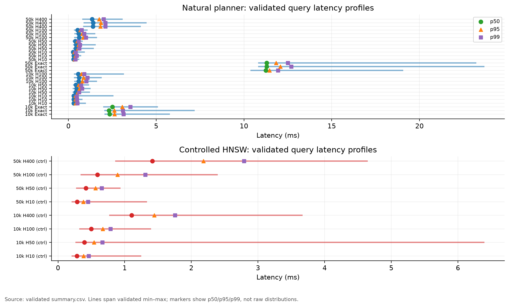
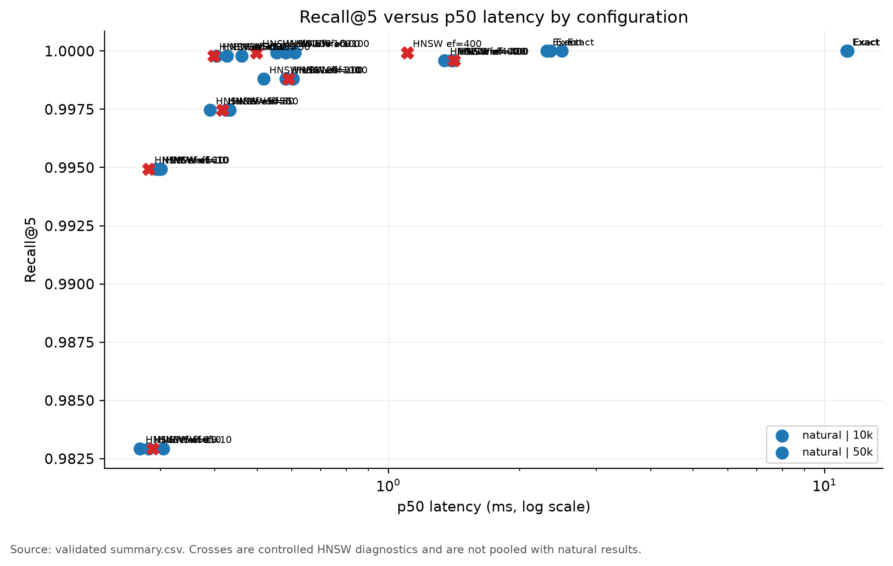
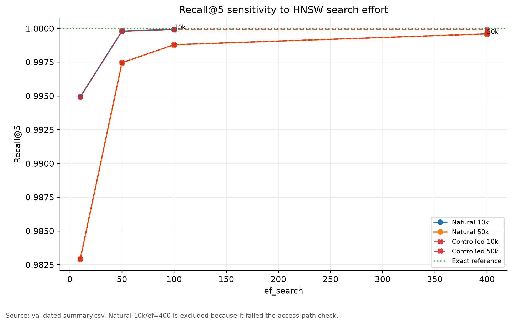
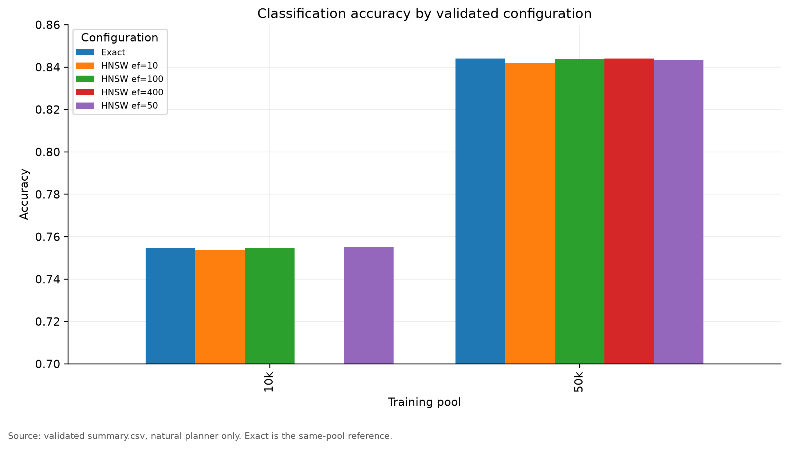
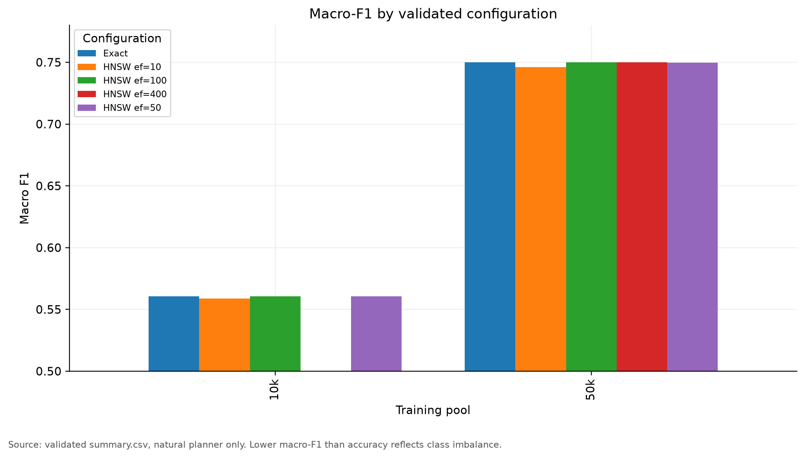
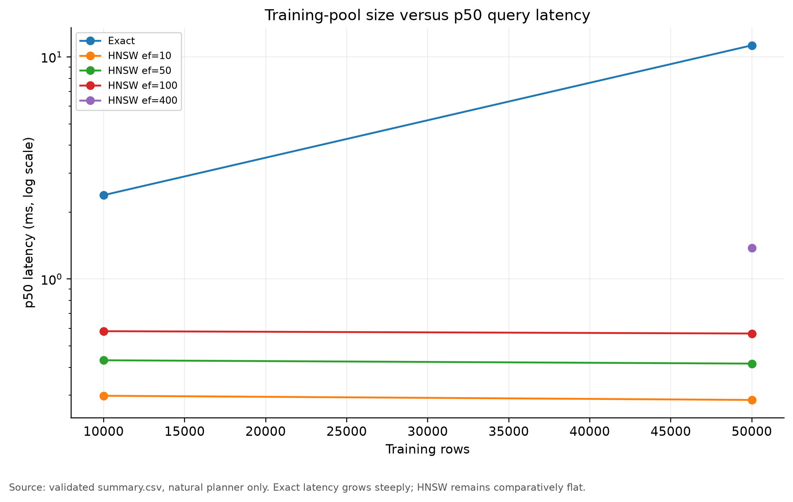
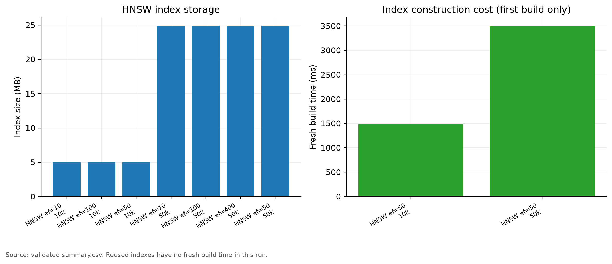
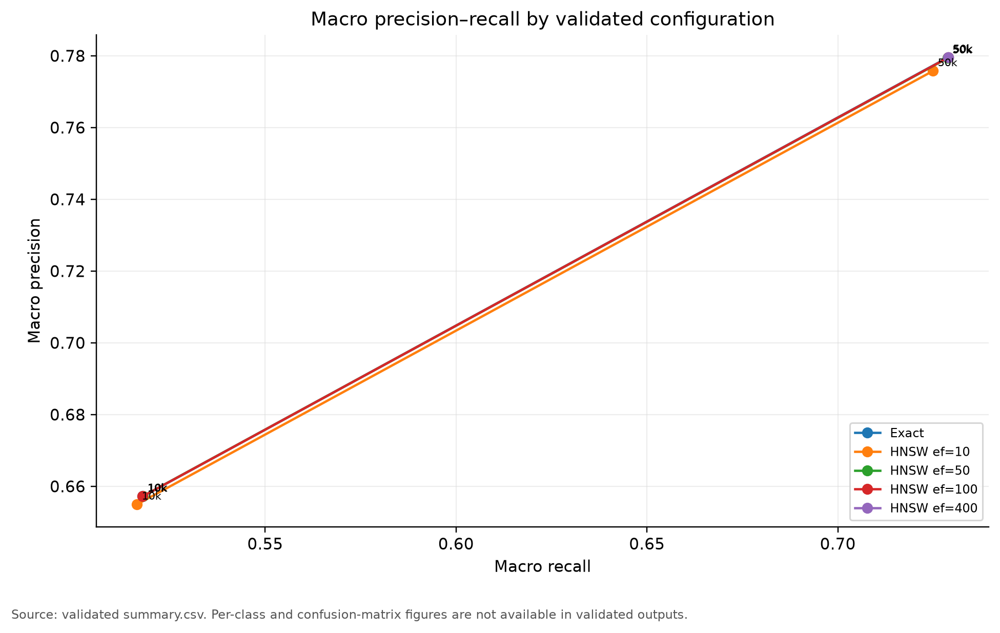

# Exact versus Approximate Nearest Neighbor Search for KNN Classification in PostgreSQL with pgvector

** MSc Digital Electronics — Semester Project**

**Research title preserved from the approved proposal.**

**Source-of-truth statement.** This thesis is written from the approved research proposal, `PHASE3-BENCHMARK-PROTOCOL.md`, `PHASE3-RESULTS-VALIDATION.md`, `PHASE4-SCIENTIFIC-ANALYSIS.md`, the verified implementation and tests, and validated figures and tables. Smoke-test measurements are not used as scientific findings. No university-specific template is assumed.

---

## Table of Contents

1. [Introduction](#chapter-1--introduction)
2. [Theoretical Foundations and Literature Review](#chapter-2--theoretical-foundations-and-literature-review)
3. [Methodology and Experimental Design](#chapter-3--methodology-and-experimental-design)
4. [System Implementation](#chapter-4--system-implementation)
5. [Experimental Results](#chapter-5--experimental-results)
6. [Discussion](#chapter-6--discussion)
7. [Conclusion and Future Work](#chapter-7--conclusion-and-future-work)
8. [References](#references)
9. [Appendices](#appendices)

---

## Chapter 1 — Introduction

### 1.1 Research background

Supervised classification assigns a class label to an unseen observation using a model fitted on labelled examples. Among the simplest and most interpretable classifiers is the *k*-Nearest Neighbors (KNN) rule: a query is labelled by a vote among its `k` closest training observations [1]. KNN is non-parametric; it does not estimate a fixed decision boundary during training but defers computation to query time.

The nearest-neighbour operation is also a database problem. As training pools grow, an exact query must compute a distance to every candidate row. In a relational system storing vectors alongside metadata, this produces a sequential scan and increasingly high latency. Approximate Nearest Neighbor (ANN) methods trade exact neighbour identity for lower query cost by traversing an index structure. Hierarchical Navigable Small World (HNSW) graphs are a prominent ANN family [3], [4], and pgvector exposes HNSW indexes inside PostgreSQL [8].

The central research problem is therefore not simply whether ANN search is faster. A classifier consumes neighbour *sets*, not just latency measurements. If an approximate index returns a different top-`k` set, classification labels and macro-averaged metrics may change. A scientifically useful comparison must connect retrieval behaviour to end-to-end supervised classification under controlled data, preprocessing, metric, voting and timing conditions.

### 1.2 Problem statement

Exact KNN retrieval guarantees the true nearest neighbours under a chosen distance metric, but its cost grows with pool size. HNSW reduces latency by traversing a graph index, but its result depends on graph construction and the search parameter `ef_search`. PostgreSQL's planner may also choose a sequential scan even when an HNSW index exists, depending on its cost model. A nominal HNSW experiment that executes a sequential scan is not an HNSW measurement and must not be reported as one.

This study evaluates the trade-off between exact and HNSW retrieval for supervised KNN classification in PostgreSQL/pgvector, with explicit access-path verification and separate natural-planner and controlled-HNSW execution modes.

### 1.3 Research motivation

Prior ANN research often reports recall or throughput in isolation [2], [4], [10], [11]. In a classification workflow, a small loss of neighbour agreement may or may not affect labels, especially under majority voting. The project is motivated by the need to:

- quantify query-latency differences using database-native execution;
- connect Recall@5 to accuracy, macro precision, macro recall and macro F1;
- include index construction time and physical storage, not only query time;
- test how training-pool size changes the trade-off;
- expose planner behaviour rather than silently forcing an index;
- preserve provenance so that every reported number is traceable.

### 1.4 Research objectives

The thesis aims to:

1. implement exact and HNSW KNN retrieval in PostgreSQL with pgvector;
2. construct a reproducible, leakage-free experimental pipeline;
3. compare retrieval and classification quality on identical queries;
4. measure latency percentiles, index build time and index size;
5. analyse the effect of `ef_search` and training-pool size;
6. separate natural planner behaviour from controlled HNSW execution;
7. validate all results statistically and report limitations honestly.

### 1.5 Research questions

The approved protocol defines nine research questions:

1. How much faster is HNSW than exact KNN?
2. What retrieval accuracy is sacrificed, if any?
3. Does retrieval recall correlate with classification performance?
4. How does `ef_search` influence recall and latency?
5. How does training dataset size affect the performance trade-off?
6. What is the index construction and storage overhead?
7. Does natural PostgreSQL planner selection differ from controlled HNSW execution?
8. Under what conditions is exact KNN preferable?
9. Under what conditions is HNSW preferable?

### 1.6 Research hypotheses

Pre-registered hypotheses were:

- **H1:** Recall@5 and neighbour agreement increase with `ef_search`, with diminishing returns; non-monotonicity is a legitimate result.
- **H2:** Classification quality approaches the exact baseline as effort increases.
- **H3:** HNSW reduces p50 and p95 latency relative to an exhaustive scan, with a larger relative advantage on larger pools.
- **H4:** Exact latency grows approximately linearly with pool size, whereas HNSW grows more slowly.
- **H5:** HNSW build time and index size increase with pool size when `m` and `ef_construction` are fixed.
- **H6:** Controlled execution can obtain valid HNSW index scans where the natural planner falls back, but is not equivalent to natural planner behaviour.

### 1.7 Scope and contributions

The experimental scope is the UCI Forest CoverType dataset [5], [6], 54-dimensional L2 vectors, `k=5`, two derived training-pool sizes (10,000 and 50,000 rows), `m=16`, `ef_construction=64`, and ef values 10, 50, 100 and 400. The study does not claim generality across datasets, distance metrics, `k` values, hardware platforms or cold-cache conditions.

The principal contributions are:

- a database-native exact/ANN comparison tied to classification outcomes;
- strict access-path validation and planner-mode separation;
- provenance for training subsets, preprocessing states, query ids and runs;
- a validated statistical protocol with paired query-level comparisons;
- reproducible validated artifacts, figures and tables.

### 1.8 Thesis organization

Chapter 2 reviews theoretical and technical foundations. Chapter 3 defines the experimental design. Chapter 4 documents the implemented system. Chapter 5 presents validated results. Chapter 6 discusses findings against the research questions and hypotheses. Chapter 7 concludes and proposes future work. Appendices provide configurations, SQL, commands and software versions.

---

## Chapter 2 — Theoretical Foundations and Literature Review

### 2.1 Supervised learning

A supervised classifier learns a mapping `f : X → Y` from labelled pairs \((x_i,y_i)\). KNN is a lazy learner: the "training" phase stores the labelled examples, and prediction is deferred until a query arrives [1]. This makes KNN sensitive to the retrieval stage because the classifier's input is exactly the retrieved neighbour set.

### 2.2 K-Nearest Neighbors

For a query \(q\), let \(R_k(q)\) be the `k` nearest training rows and \(y_i\) their class labels. Unweighted majority voting predicts

\[
\hat{y}(q)=\arg\max_{c\in C}\sum_{(x_i,y_i)\in R_k(q)}\mathbf{1}[y_i=c].
\tag{1}
\]

Ties in this implementation are resolved deterministically by the lower encoded label. This rule is used identically for exact and HNSW arms.

### 2.3 Distance metrics

For vectors \(x,q\in\mathbb{R}^d\), Euclidean (L2) distance is

\[
d_2(x,q)=\sqrt{\sum_{j=1}^{d}(x_j-q_j)^2}.
\tag{2}
\]

L1 distance is \(\sum_j |x_j-q_j|\), and cosine distance is \(1-\frac{x\cdot q}{\|x\|\|q\|}\). The experiment uses L2 because it is the primary metric in the approved protocol and corresponds to pgvector's `<->` operator and `vector_l2_ops` index class [8]. The exact baseline uses the pgvector distance *function* form, while HNSW uses the index-compatible operator form.

### 2.4 Exact nearest-neighbor search

Exact search computes the distance from the query to every row in the training pool, then sorts by distance and returns `k` rows. Its complexity is linear in the number of candidates for a single query. This guarantee is valuable as ground truth and for deterministic behaviour, but it becomes costly at scale.

The exhaustive reference query applies an `id` tiebreak after distance so that repeated exact queries return stable identifiers. Tie-aware Recall@5 was implemented in the platform but is not needed for the validated main analysis of this thesis.

### 2.5 Approximate nearest-neighbor search

ANN methods trade a controlled amount of retrieval error for sublinear query effort. Indyk and Motwani formalized approximate nearest-neighbour algorithms as a response to the curse of dimensionality [2]. ANN-Benchmarks demonstrated that algorithm comparisons require consistent datasets, metrics and recall targets rather than isolated speed claims [11]. FAISS showed how approximate similarity search can scale to billions of vectors [10].

### 2.6 HNSW graph structure

Navigable Small World graphs connect nodes to nearby and long-range neighbours, enabling greedy routing [3]. HNSW extends this idea with a hierarchy of layers: upper layers contain sparse long-range links, while lower layers contain denser neighbourhoods [4]. A query enters near the top and descends, refining candidates at each level.

### 2.7 HNSW parameters

`m` controls the maximum number of bi-directional links per node, and `ef_construction` controls the candidate list during index build. At query time, `ef_search` controls the dynamic candidate list. Larger `ef_search` generally improves recall and increases latency, although heuristic graph traversal does not guarantee strict monotonicity [4], [8]. This study keeps `m=16` and `ef_construction=64` fixed and varies only `ef_search` under a single index per pool.

### 2.8 PostgreSQL and pgvector

PostgreSQL is an object-relational database with extensible index access methods [7]. pgvector adds vector types, distance operators and HNSW/IVFFlat indexes [8]. Relevant operators include `<->` for L2, `<=>` for cosine and `<+>` for L1. pgvector documents `hnsw.ef_search` as the dynamic candidate-list size, defaulting to 40, and supports transaction-local `SET LOCAL` [8].

The database is not merely storage: the planner chooses the access path. A valid HNSW experiment must verify that the executed plan uses the expected HNSW index. The Phase 2 investigation established that pgvector's cost estimate increases with `ef_search`, which can make a sequential scan cheaper on a small pool.

### 2.9 Vector indexing and storage

An HNSW index is a physical relation with measurable size. The insertion and graph connectivity work is paid at build time; subsequent ef configurations can reuse the same index. Reporting index size and one-time build time is therefore necessary for a fair systems comparison. Storage overhead can be expressed as

\[
O_{\text{index}}=\frac{S_{\text{index}}}{S_{\text{table}}}.
\tag{3}
\]

### 2.10 Retrieval quality and Recall@K

Let \(R_K(q)\) be retrieved ids and \(G_K(q)\) exact top-`k` ids for query \(q\). Conventional Recall@K is

\[
\text{Recall@K}=\frac{1}{|Q|}\sum_{q\in Q}\frac{|R_K(q)\cap G_K(q)|}{K}.
\tag{4}
\]

Neighbour agreement can additionally be measured by the Jaccard index:

\[
J(q)=\frac{|R_K(q)\cap G_K(q)|}{|R_K(q)\cup G_K(q)|}.
\tag{5}
\]

Recall@K measures identifier-level agreement; it is not identical to classification correctness because multiple neighbours may carry the same label.

### 2.11 Classification metrics

For each class \(c\), with true positives \(TP_c\), false positives \(FP_c\) and false negatives \(FN_c\):

\[
P_c=\frac{TP_c}{TP_c+FP_c},\quad
R_c=\frac{TP_c}{TP_c+FN_c},\quad
F1_c=\frac{2P_cR_c}{P_c+R_c}.
\tag{6}
\]

Macro precision, recall and F1 are unweighted means over classes. Accuracy is \(\frac{1}{N}\sum_i\mathbf{1}[\hat y_i=y_i]\). Macro metrics are important for the imbalanced Covertype classes [5].

Latency percentiles are computed from all stored query observations. Speed-up is

\[
S_p=\frac{L^{\text{exact}}_p}{L^{\text{HNSW}}_p},
\tag{7}
\]

where \(L_p\) denotes a percentile such as p50.

### 2.12 Related research

Cover and Hart established the theoretical basis for nearest-neighbour classification [1]. Indyk and Motwani introduced approximate nearest-neighbour algorithms as a way to mitigate high-dimensional search cost [2]. Malkov *et al.* developed navigable small-world graphs [3], and Malkov and Yashunin introduced HNSW [4]. The Covertype dataset used here was described by Blackard and Dean [5] and is distributed by the UCI Machine Learning Repository [6]. Pedregosa *et al.* describe the scikit-learn environment in which parts of the preprocessing stack originated [9]. Database-native vector search is documented by PostgreSQL [7] and pgvector [8]. Large-scale ANN systems and benchmarking practice are represented by FAISS [10] and ANN-Benchmarks [11]. This thesis differs from these works by joining ANN retrieval quality to KNN classification metrics inside a reproducible PostgreSQL experiment with planner verification.

---

## Chapter 3 — Methodology and Experimental Design

### 3.1 Dataset description

The raw UCI Covertype dataset contains 581,012 observations, 54 features and seven forest-cover classes [5], [6]. The platform's dataset 116 contains a 50,000-row training pool and a 3,000-row held-out query pool. Derived variants with 10,000 and 50,000 training rows were created from seed 0 using stratified largest-remainder allocation. The 50,000-row variant uses all available parent training rows and is a fresh refit/copy, not an independent sample.

### 3.2 Data preprocessing and feature transformation

The Covertype preprocessing mode standardises ten continuous features and leaves 44 binary wilderness/soil indicators unscaled. For a derived pool, stored vectors are inverse-transformed and preprocessing is refitted on that pool's selected training rows only. The held-out rows are transformed using the fitted state. The fitted state, dataset fingerprint and preprocessing-state hash are persisted for provenance.

No test labels are used to fit scalers, choose training rows or define preprocessing. Query ids are drawn from the held-out table only.

### 3.3 Training and testing strategy

Each pool size owns two tables: `fv_<id>` for training candidates and `tv_<id>` for held-out queries. Exact and HNSW configurations query the same training table and the same 3,000 query ids. The query set is the entire held-out pool, selected with stratified sampling mode and seed 0. This eliminates query-sampling variability within a size.

### 3.4 Exact KNN implementation

The exact arm uses:

```sql
SELECT id, label, l2_distance(embedding, %s::vector) AS distance
FROM fv_<id>
ORDER BY distance, id
LIMIT 5;
```

The distance-function form cannot use an HNSW index, guaranteeing an exhaustive path. The `id` tiebreak ensures deterministic identifiers.

### 3.5 HNSW implementation

The approximate arm uses:

```sql
SELECT id, label, embedding <-> %s AS distance
FROM fv_<id>
ORDER BY embedding <-> %s
LIMIT 5;
```

The index is built with:

```sql
CREATE INDEX fv_<id>_embedding_hnsw_idx
ON fv_<id> USING hnsw (embedding vector_l2_ops)
WITH (m = 16, ef_construction = 64);
```

For each HNSW query, the implementation verifies the index in the PostgreSQL catalog, applies ef on the executing connection, confirms it with `SHOW`, verifies the plan after the timed query, and restores the previous GUC value.

### 3.6 Experimental configurations

| Factor | Levels |
|---|---|
| Training size | 10,000; 50,000 |
| Retrieval | Exact; HNSW |
| `ef_search` | 10; 50; 100; 400 (HNSW only) |
| Planner mode | natural; controlled HNSW |
| Rounds | 3 |
| Repetitions per run | 3 |
| Queries per run | 3,000 |
| `k` | 5 |
| Metric | L2 |
| HNSW build | `m=16`, `ef_construction=64` |

The primary natural matrix has 30 runs. A separate controlled-HNSW diagnostic has 8 runs. The modes are never pooled.

### 3.7 Controlled variables

Controlled variables include parent dataset, query ids, preprocessing state, distance metric, `k`, voting rule, HNSW build parameters, seeds, timing boundary and cache policy. All measurements use a warm buffer cache; no cold-cache claim is made.

### 3.8 Performance metrics

Metrics are grouped into retrieval (Recall@5, Jaccard), classification (accuracy, macro precision/recall/F1), latency (p50/p95/p99/min/max and throughput), and index cost (build time and size). The validated summary contains per-experiment metrics across rounds.

### 3.9 Statistical methodology

The query id is the unit of inference. Nine passes (three rounds × three repetitions) are aggregated per query: median latency and majority-vote classification correctness. Natural HNSW configurations are paired with the exact baseline on the same pool and query ids.

Latency uses a two-sided Wilcoxon signed-rank test on paired per-query median differences, percentile bootstrap confidence intervals with 10,000 resamples (seed 20261123), and rank-biserial effect sizes. Recall and accuracy use paired bootstrap intervals; classification uses exact McNemar tests on paired binary correctness. Holm correction is applied across ef levels within each pool size. Outliers are retained and reported through p99 and maxima. No significance threshold is treated as proof of practical superiority.

### 3.10 Reproducibility procedures

A `pg_dump -Fc` backup was taken before execution. Configurations, balanced orders, query ids, variant identities, preprocessing hashes and experiment ids were persisted. The final artifacts were independently validated; raw measurements were not modified. The validation script and figure generator are preserved in the repository.

---

## Chapter 4 — System Implementation

### 4.1 System architecture

```text
CSV / UCI Covertype
        │
        ▼
Preprocessing + stratified subsampling
        │
        ▼
datasets row + fv_<id> / tv_<id> vector tables
        │
        ├── Exact arm: l2_distance() → Seq Scan → top-k ids
        │
        └── HNSW arm: <-> operator → HNSW Index Scan → top-k ids
                         │
                         ├── ef_search SET/SHOW on executing connection
                         └── catalog + EXPLAIN plan verification
        │
        ▼
Majority vote → accuracy / macro precision / macro recall / macro F1
        │
        ▼
experiments + experiment_repetitions + query_latencies
        │
        ▼
validated summaries → figures → scientific analysis → thesis
```

### 4.2 Database schema

The core tables are:

- `datasets`: dataset metadata, preprocessing state, fingerprint, dimensions, classes.
- `hnsw_indexes`: registry of build parameters and measured build time.
- `experiments`: configuration, metrics, timing decomposition, plan flags, environment.
- `experiment_repetitions`: one row per repetition and experiment.
- `query_latencies`: one row per timed query with `retrieved_ids`.
- `fv_<id>` and `tv_<id>`: per-dataset typed vector tables.

Using one table pair per dataset preserves fixed vector dimensionality and avoids cross-dataset neighbour contamination.

### 4.3 Vector storage

Vectors are stored in `vector(54)` columns. The dimension is part of the table type, and COPY is used for ingestion. Each variant has its own fitted preprocessing state, so the query vectors for different sizes are not directly interchangeable; comparisons are made within a size.

### 4.4 Index construction

`ensure_hnsw_index()` checks the registry and catalog, builds an index if required, records build time and size, and reuses an equivalent index otherwise. The first HNSW configuration pays the build cost; later ef values reuse the index. This mirrors a realistic search-effort sweep and avoids double-charging construction.

### 4.5 Retrieval pipeline

Pseudocode for one timed query:

```text
verify HNSW index exists, is hnsw/opclass-compatible and valid
if natural mode: SET hnsw.ef_search = ef
if controlled mode: inside BEGIN, SET LOCAL hnsw.ef_search = ef
execute warm-up query (first query only)
start timer
execute top-k SELECT
fetch rows
stop timer
EXPLAIN the same SQL shape and verify access path
restore previous ef setting or roll back transaction
persist latency and retrieved ids
```

### 4.6 Classification pipeline

Neighbour labels are joined from `fv_<id>` by retrieved id, and majority voting is applied. Metrics are computed per repetition and summarised across three repetitions. Exact and HNSW use the same voting function. The validated recomputation joined labels from the correct variant tables and found exact agreement with stored metrics.

### 4.7 Experiment orchestration

The runner creates derived variants, builds balanced round permutations, executes exact and HNSW configurations, captures provenance and writes CSV/JSON artifacts. A timeout interruption during Phase 3 was handled by resuming only missing configurations; no completed experiment was deleted or overwritten. Artifacts were rebuilt from preserved database rows.

### 4.8 Measurement methodology

Per-query latency measures client-side `execute + fetch` with `time.perf_counter()`. The detailed EXPLAIN is captured for the first query; an additional cheap EXPLAIN verifies each timed HNSW query after its timer stops. Timing phases are non-overlapping: index preparation, ground truth, retrieval wall time, metrics, persistence and orchestration.

### 4.9 Artifact generation

Artifacts include `sweep.csv/json`, repetition details and summaries, query samples, benchmark orders, variant ids, controlled diagnostics, validation summaries and research tables. `scripts/verify_results.py` was retained but is incompatible with the approved four-ef matrix and option-A failed HNSW rows; a purpose-built validator passed with zero errors.

### 4.10 Implementation verification

The full backend test suite was executed on an isolated database: 272 passed, one pre-existing skip. Phase 2 regression tests covered index verification, ef application, no setting leakage, small-pool fallback, exact-search integrity and Phase 1 transaction guarantees.

---

## Chapter 5 — Experimental Results

All numbers in this chapter come from validated artifacts. Smoke-test metrics are excluded.

### 5.1 Dataset characteristics and configurations

Two variants were used: 10,000 and 50,000 training rows, each with 3,000 held-out queries. The validated natural matrix has 27 successful records: six exact baselines and 21 valid HNSW runs. Three natural HNSW runs at 10k/ef=400 failed access-path validation. Eight controlled HNSW runs form a separate diagnostic group.

### 5.2 Execution-path verification

Valid exact runs used sequential scans by construction. Valid HNSW runs used the expected `fv_<id>_embedding_hnsw_idx`. The failed natural 10k/ef=400 runs used sequential scans and were excluded from HNSW performance summaries. All controlled runs used the verified HNSW index.

**Table 1. Main benchmark comparison.** Means over three valid natural rounds. The 10k/ef=400 cell is absent because all three natural executions failed the access-path check.

| Pool | Configuration | Recall@5 | Jaccard | Accuracy | Macro F1 | p50 (ms) | p95 (ms) | Speed-up |
|---:|---|---:|---:|---:|---:|---:|---:|---:|
| 10,000 | Exact | 1.0000 | 1.0000 | 0.7547 | 0.5605 | 2.386 | 2.765 | — |
| 10,000 | HNSW ef=10 | 0.9949 | 0.9931 | 0.7537 | 0.5588 | 0.298 | 0.398 | 8.01× |
| 10,000 | HNSW ef=50 | 0.9998 | 0.9997 | 0.7550 | 0.5606 | 0.431 | 0.579 | 5.56× |
| 10,000 | HNSW ef=100 | 0.9999 | 0.9999 | 0.7547 | 0.5605 | 0.582 | 0.798 | 4.11× |
| 50,000 | Exact | 1.0000 | 1.0000 | 0.8440 | 0.7500 | 11.278 | 11.786 | — |
| 50,000 | HNSW ef=10 | 0.9829 | 0.9814 | 0.8420 | 0.7460 | 0.285 | 0.361 | 39.63× |
| 50,000 | HNSW ef=50 | 0.9975 | 0.9970 | 0.8433 | 0.7498 | 0.416 | 0.539 | 27.17× |
| 50,000 | HNSW ef=100 | 0.9988 | 0.9984 | 0.8437 | 0.7499 | 0.568 | 0.764 | 19.94× |
| 50,000 | HNSW ef=400 | 0.9996 | 0.9994 | 0.8440 | 0.7500 | 1.381 | 1.805 | 8.17× |

Complete per-configuration records are preserved in `tables/per_configuration_metrics.csv`.

**Figure 1. Latency profiles by configuration.** Lines span validated min–max latency; markers show p50, p95 and p99. The top panel is natural planner mode and the bottom panel is controlled HNSW. These are validated percentile profiles, not raw distribution plots.



### 5.3 Latency analysis

Every valid HNSW configuration had lower p50 and p95 latency than exact search. The absolute paired latency advantage was 1.73–2.04 ms at 10k and 9.80–10.93 ms at 50k. Relative speed-ups ranged from 4.11× to 8.01× at 10k and from 8.17× to 39.63× at 50k.

**Figure 2. Recall@5 versus p50 latency.** Points are validated configurations; crosses denote controlled HNSW diagnostics and are not pooled with natural results.



### 5.4 Retrieval performance

Exact search attained Recall@5 = 1.0 by definition. HNSW recall losses were small but measurable. At 10k, mean Recall@5 ranged from 0.9949 at ef=10 to 0.9999 at ef=100. At 50k, it ranged from 0.9829 at ef=10 to 0.9996 at ef=400. Neighbour Jaccard followed the same pattern.

**Figure 3. Recall@5 sensitivity to `ef_search`.** The natural 10k/ef=400 point is absent because it failed access-path validation; controlled points are shown separately.



### 5.5 Classification performance

Classification differences were small. At 10k, exact accuracy was 0.7547 and HNSW values were 0.7537–0.7550. At 50k, exact accuracy was 0.8440 and HNSW values were 0.8420–0.8440. Macro-F1 values showed the same pattern.

**Figure 4. Classification accuracy by validated configuration.** Exact is the same-pool reference; natural planner only.



**Figure 5. Macro-F1 by validated configuration.** Lower values than accuracy reflect the seven-class imbalance.



### 5.6 Training-size sensitivity

**Figure 6. Training-pool size versus p50 query latency.** Exact latency increases strongly with pool size, while HNSW remains comparatively flat.



Exact p50 rose from 2.386 ms to 11.278 ms, about 4.7×. HNSW p50 at ef=50 changed from 0.431 ms to 0.416 ms. Thus the relative benefit of indexing grew with pool size.

### 5.7 Index construction and storage

**Table 2. Index construction and storage.** Build time is reported only for the first fresh build per pool; later ef configurations reused the index.

| Pool | Fresh build time (ms) | Index size (bytes) | Index size (MB) |
|---:|---:|---:|---:|
| 10,000 | 1,478.5 | 5,226,496 | 4.984 |
| 50,000 | 3,500.2 | 26,083,328 | 24.875 |

**Figure 7. HNSW index storage and first-build cost.** Reused indexes have no fresh build time in these runs.



### 5.8 Statistical comparison

**Table 3. Statistical comparison.** Differences are HNSW minus exact. Wilcoxon p-values underflowed below 1e-300; McNemar values are Holm-adjusted within size.

| Pool | ef | Median Δ p50 (ms) | Rank-biserial | Δ Recall@5 | Δ accuracy | McNemar p (Holm) |
|---:|---:|---:|---:|---:|---:|---:|
| 10,000 | 10 | −2.043 | −1.000 | −0.0051 | −0.0010 | 1.000 |
| 10,000 | 50 | −1.935 | −1.000 | −0.0002 | +0.0003 | 1.000 |
| 10,000 | 100 | −1.731 | −1.000 | −0.0001 | 0.0000 | 1.000 |
| 50,000 | 10 | −10.927 | −1.000 | −0.0171 | −0.0020 | 1.000 |
| 50,000 | 50 | −10.803 | −1.000 | −0.0025 | −0.0007 | 1.000 |
| 50,000 | 100 | −10.654 | −1.000 | −0.0012 | −0.0003 | 1.000 |
| 50,000 | 400 | −9.798 | −1.000 | −0.0004 | 0.0000 | 1.000 |

Full intervals and test statistics remain in `tables/statistical_comparison.csv`.

**Figure 8. Macro precision–recall by validated configuration.** This is the available class-level proxy; per-class matrices were not exported to validated outputs.



---

## Chapter 6 — Discussion

### 6.1 Answers to research questions

**RQ1 — How much faster is HNSW?** In the validated natural configurations, HNSW was 4.11–8.01× faster at 10k and 8.17–39.63× faster at 50k by p50 speed-up. Paired tests showed every aggregated query was faster under HNSW. This supports H3 but does not establish universal superiority.

**RQ2 — What retrieval accuracy is sacrificed?** Recall@5 loss was very small at higher ef and larger at ef=10, especially on 50k. Exact remained the only method with perfect identifier-level agreement. This partially supports H1: recall improves with effort, with diminishing returns.

**RQ3 — Does recall correlate with classification performance?** Within a pool size, recall and accuracy moved together descriptively, but classification differences were not statistically significant after Holm correction. Pooled across sizes, correlation became negative because size confounded the relationship. Recall is therefore not a sufficient proxy for classification quality.

**RQ4 — How does ef_search influence recall and latency?** Higher ef generally improved recall and increased latency. Largest gains occurred between ef=10 and ef=50. This supports H1 and the expected ANN trade-off.

**RQ5 — How does training size affect the trade-off?** Exact latency grew sharply; HNSW latency stayed nearly flat. The relative advantage widened with pool size, supporting H4.

**RQ6 — What is the construction and storage overhead?** Indexes used 4.984 MB at 10k and 24.875 MB at 50k, with fresh build times of 1.48 s and 3.50 s. Costs were modest relative to repeated query savings but non-zero, supporting H5.

**RQ7 — Does natural planner selection differ from controlled HNSW?** Yes. At 10k/ef=400, the natural planner chose sequential scans; the controlled diagnostic obtained valid index scans. The modes must remain separate, supporting H6.

**RQ8 — When is exact KNN preferable?** Exact is preferable when deterministic full recall is required, when a pool is small enough that absolute latency savings are minor, or when planner instability would be unacceptable.

**RQ9 — When is HNSW preferable?** HNSW is preferable for larger pools with warm-cache latency requirements where a measured, small recall loss is acceptable and ef is chosen from empirical trade-offs.

### 6.2 Evaluation of hypotheses

H1-H6 are supported within the constraints of this experiment. Non-monotonicity was not observed in the valid natural cells, but the failed 10k/ef=400 cell prevents a complete four-ef assessment at that size. H2 is supported descriptively but not by statistically significant classification differences. H3-H5 are strongly supported by latency and index evidence. H6 is supported by the planner-fallback diagnostic.

### 6.3 Exact versus approximate trade-offs

Exact search offers determinism and full recall at linearly growing query cost. HNSW offers lower, stable latency at the price of approximate neighbour sets and index overhead. The classification layer was robust to small recall losses because majority voting tolerates substitution among neighbours with the same label.

### 6.4 PostgreSQL planner behaviour

The planner's ef-dependent cost model caused a sequential scan at 10k/ef=400. The Phase 2 remediation records such runs as failed HNSW experiments instead of silently relabelling exhaustive scans. Controlled mode with `SET LOCAL enable_seqscan=off` is a legitimate diagnostic but changes the experimental condition and cannot be pooled with natural results.

### 6.5 Practical implications

For a 50k-row pool, ef=50 achieved Recall@5 = 0.9975 and p50 = 0.416 ms versus exact p50 = 11.278 ms. This suggests HNSW is attractive when query latency dominates and negligible recall loss is acceptable. For smaller pools or legal/scientific settings requiring exact neighbour identity, exact search remains defensible.

### 6.6 Threats to validity

Threats include one dataset family, one distance metric, one `k`, a warm cache, client-side timing, three rounds, repeated-query correlation, one failed natural cell, and unavailable per-class exports. The results are specific to PostgreSQL 18.0 and pgvector 0.8.7 on the tested machine.

### 6.7 Limitations

The thesis does not assess cold cache, concurrent workloads, GPU acceleration, other ANN algorithms, other `k` values, cosine/L1 metrics or multi-dataset generalisation. Per-class/confusion-matrix conclusions cannot be drawn from the validated exports. Statistical significance of latency does not prove practical superiority because no practical threshold was pre-registered.

---

## Chapter 7 — Conclusion and Future Work

### 7.1 Research summary

This project implemented and validated a PostgreSQL/pgvector platform for comparing exact and HNSW KNN classification. It used leakage-free preprocessing, identical query sets, provenance hashes, balanced rounds, repeated timed passes, access-path verification and paired statistical analysis.

### 7.2 Main findings

HNSW provided large latency reductions, especially at 50k rows, while Recall@5 losses were small at moderate and high ef. Classification differences were not statistically significant after Holm correction. Higher ef increased recall and latency with diminishing returns. Index build time and storage were one-time and modest. Natural planner fallback at 10k/ef=400 was observed and handled as a failed HNSW access-path result, not as an HNSW measurement.

### 7.3 Contributions

The work contributes a rigorous database-native experimental design, a validated implementation with planner-mode separation, complete provenance, and reproducible validated artifacts and analysis. It also demonstrates why nominal ANN runs require plan verification before scientific interpretation.

### 7.4 Limitations

The conclusions are bounded by the validated dataset, metric, parameter set, hardware and cache state. The study does not establish universal superiority of either method and does not support per-class conclusions because those matrices were not exported to validated outputs.

### 7.5 Future research

Future work should evaluate additional datasets, metrics and `k` values; cold-cache and concurrent workloads; alternative ANN indexes; dynamic insertion and deletion; multi-machine replication; and per-class error exported into validated artifacts. A formal cost model linking pgvector planner estimates to ef and table size would also be valuable.

---

## References

[1] T. M. Cover and P. E. Hart, "Nearest neighbor pattern classification," *IEEE Transactions on Information Theory*, vol. 13, no. 1, pp. 21–27, 1967, doi: 10.1109/TIT.1967.1053964.

[2] P. Indyk and R. Motwani, "Approximate nearest neighbors: Towards removing the curse of dimensionality," in *Proc. 30th Annual ACM Symposium on Theory of Computing (STOC '98)*, 1998, pp. 604–613, doi: 10.1145/276698.276876.

[3] Y. Malkov, A. Ponomarenko, A. Logvinov, and V. Krylov, "Approximate nearest neighbor algorithm based on navigable small world graphs," *Information Systems*, vol. 45, pp. 61–68, 2014, doi: 10.1016/j.is.2013.10.006.

[4] Y. A. Malkov and D. A. Yashunin, "Efficient and robust approximate nearest neighbor search using Hierarchical Navigable Small World graphs," *IEEE Transactions on Pattern Analysis and Machine Intelligence*, vol. 42, no. 4, pp. 824–836, 2020, doi: 10.1109/TPAMI.2018.2889473.

[5] J. A. Blackard and D. J. Dean, "Comparative accuracies of artificial neural networks and discriminant analysis in predicting forest cover types from cartographic variables," *Computers and Electronics in Agriculture*, vol. 24, no. 3, pp. 131–151, 1999, doi: 10.1016/S0168-1699(99)00046-0.

[6] J. Blackard, "Covertype [Dataset]," UCI Machine Learning Repository, 1998, doi: 10.24432/C50K5N. Accessed Nov. 24, 2026.

[7] PostgreSQL Global Development Group, "PostgreSQL 18 Documentation," 2026. [Online]. Available: https://www.postgresql.org/docs/18/. Accessed Nov. 24, 2026.

[8] pgvector contributors, "pgvector: Open-source vector similarity search for Postgres," 2026. [Online]. Available: https://github.com/pgvector/pgvector. Accessed Nov. 24, 2026.

[9] F. Pedregosa *et al.*, "Scikit-learn: Machine learning in Python," *Journal of Machine Learning Research*, vol. 12, no. 85, pp. 2825–2830, 2011.

[10] J. Johnson, M. Douze, and H. Jégou, "Billion-scale similarity search with GPUs," *IEEE Transactions on Big Data*, vol. 7, no. 3, pp. 535–547, 2021, doi: 10.1109/TBDATA.2019.2921572.

[11] M. Aumüller, E. Bernhardsson, and A. Faithfull, "ANN-Benchmarks: A benchmarking tool for approximate nearest neighbor algorithms," *Information Systems*, vol. 87, 101374, 2020, doi: 10.1016/j.is.2019.02.006.

---

## Appendices

### Appendix A — Experimental configurations

| Parameter | Value |
|---|---|
| Dataset | UCI Covertype-derived dataset 116 |
| Training pools | 10,000; 50,000 |
| Held-out queries | 3,000 |
| k | 5 |
| Metric | L2 |
| HNSW m | 16 |
| HNSW ef_construction | 64 |
| ef_search | 10, 50, 100, 400 |
| Rounds | 3 |
| Repetitions | 3 |
| Seeds | training 0, query 0, order 0, bootstrap 20261123 |
| Planner modes | natural; controlled_hnsw |

### Appendix B — Important SQL queries

Exact baseline:

```sql
SELECT id, label, l2_distance(embedding, %s::vector) AS distance
FROM fv_<id>
ORDER BY distance, id
LIMIT 5;
```

HNSW operator query:

```sql
SELECT id, label, embedding <-> %s AS distance
FROM fv_<id>
ORDER BY embedding <-> %s
LIMIT 5;
```

Plan verification:

```sql
EXPLAIN (ANALYZE, BUFFERS, FORMAT TEXT)
SELECT id, label, embedding <-> %s AS distance
FROM fv_<id>
ORDER BY embedding <-> %s
LIMIT 5;
```

Controlled HNSW mode:

```sql
BEGIN;
SET LOCAL enable_seqscan = off;
SET LOCAL hnsw.ef_search = 400;
-- timed retrieval queries
ROLLBACK;
```

### Appendix C — Reproducibility commands

```bash
cd backend
.venv/Scripts/python.exe -m scripts.validate_phase3_results
.venv/Scripts/python.exe ../scripts/generate_research_figures.py
```

The natural benchmark command and controlled diagnostic command are preserved verbatim in `PHASE3-BENCHMARK-PROTOCOL.md` and `PHASE3-FULL-BENCHMARK-REPORT.md`.

### Appendix D — Software versions

| Component | Version |
|---|---|
| Python | 3.12.1 |
| PostgreSQL | 18.0 |
| pgvector | 0.8.7 |
| NumPy | 2.5.4 |
| pandas | 3.1.1 |
| matplotlib | 3.11.2 |

### Appendix E — Additional tables and availability notice

Copies of all validated research tables are in `tables/`. `tables/per_class_results.csv` explicitly records that per-class matrices were recomputed during validation but were not exported to `docs/results/validated/`; no per-class claims are made in this thesis.
